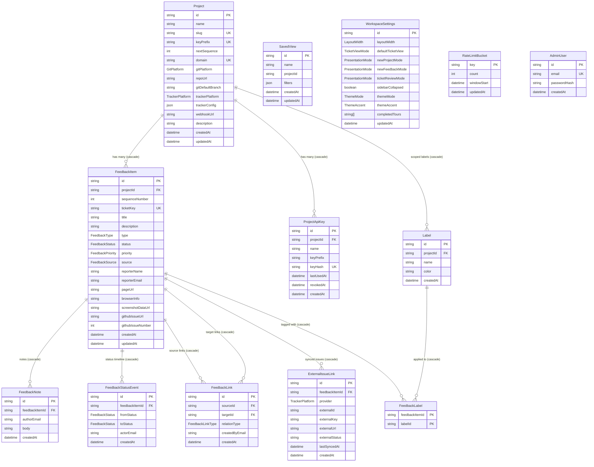

# Data Model & Migrations

The database schema is managed by **Prisma 6.19.3** (`prisma/schema.prisma`, configured via `prisma.config.ts`) on **PostgreSQL 16**. Primary keys use `cuid()` except `WorkspaceSettings.id` (singleton `"default"`), `RateLimitBucket.key`, and the composite primary key on `FeedbackLabel`. Relational children cascade on parent deletion.

---

## Entity-Relationship Diagram

---

## Enums

| Enum | Values | Notes |
| --- | --- | --- |
| `FeedbackType` | `bug`, `improvement`, `feature`, `question` | Required on all feedback items |
| `FeedbackStatus` | `open`, `todo`, `in_progress`, `blocked`, `resolved`, `closed` | Defaults to `open`; strict transitions enforced by `lib/workflow.ts` |
| `FeedbackPriority` | `low`, `medium`, `high`, `urgent` | Nullable on `FeedbackItem`; ordered ascending so `ORDER BY priority DESC` sorts `urgent` first |
| `FeedbackSource` | `manual`, `public_form`, `extension`, `api` | Defaults to `manual` |
| `GitPlatform` | `none`, `github`, `gitlab`, `bitbucket`, `azure_devops`, `gitea`, `custom` | Defaults to `none`; auto-detected from `Project.repoUrl` when omitted |
| `TrackerPlatform` | `none`, `github_issues`, `gitlab_issues`, `linear`, `jira`, `bitbucket_issues` | Defaults to `none`; configures external issue promotion & sync |
| `FeedbackLinkType` | `blocks`, `causes`, `duplicates`, `relates_to`, `parent_of` | Canonical directed ticket relationships (inverses computed dynamically) |
| `LayoutWidth` | `full`, `wide`, `narrow` | Workspace container width (`100%`, `1280px`, `1024px`); defaults to `full` |
| `PresentationMode` | `page`, `modal`, `drawer` | Surface mode for New Project, New Feedback, and Ticket Review |
| `TicketViewMode` | `list_full`, `list_fixed`, `grid`, `kanban` | Default ticket board layout; defaults to `list_full` |
| `ThemeMode` | `system`, `light`, `dark` | Color scheme preference; defaults to `system` |
| `ThemeAccent` | `slate`, `indigo`, `emerald`, `amber`, `rose` | Accent palette preference; defaults to `slate` |

---

## Table Reference

### `Project`
- `slug` (`@unique`) is generated by `lib/slug.ts` with numeric collision suffixes (`-1`, `-2`, ...).
- `keyPrefix` (`@unique`, default `"PRJ"`) and `nextSequence` (default `1`) drive atomic sequential ticket key generation (`WEB-1`, `PAY-42`) via `allocateNextTicketKey()` in `lib/ticket-keys.ts`.
- `domain` (`@unique`, nullable) is normalized to a lowercase hostname (`lib/domain.ts`) for Chrome extension lookup.
- `gitPlatform`, `repoUrl`, and `gitDefaultBranch` capture source repository hosting metadata (auto-detected via `detectGitPlatform()`).
- `trackerPlatform` and `trackerConfig` (`Json?`) store non-secret external tracker settings (`owner`, `repo`, `gitlabBaseUrl`, `gitlabProjectId`, `linearTeamId`, `linearProjectId`, `jiraSiteUrl`, `jiraProjectKey`, `jiraIssueType`, `bitbucketWorkspace`, `bitbucketRepoSlug`).
- `webhookUrl` stores an optional Slack, Discord, or generic HTTP(S) webhook URL notified on intake.

### `FeedbackItem`
- Indexed on `projectId`, `status`, and `priority`, and cascades on `Project` deletion.
- `sequenceNumber` (default `0`) and `ticketKey` (`@unique`, nullable for legacy compatibility) store human-readable keys like `BILL-12`.
- Stores GFM Markdown in `description`, structured capture metadata (`pageUrl`, `browserInfo`, `screenshotDataUrl`), and legacy GitHub fields (`githubIssueUrl`, `githubIssueNumber`, kept synchronized when promoting to GitHub Issues).

### `FeedbackLink`
- Models canonical directed edges (`sourceId`, `targetId`, `relationType`, `createdByEmail`) with a composite unique constraint `@@unique([sourceId, targetId, relationType])` and indexes on `sourceId` and `targetId`.
- Inverse directions (`is_blocked_by`, `is_caused_by`, `is_duplicated_by`, `subtask_of`) are normalized to their canonical edge before insert (`lib/ticket-links.ts`) and resolved symmetrically on read.

### `ExternalIssueLink`
- Tracks issues pushed to or manually linked with external trackers (`provider`, `externalId`, `externalKey`, `externalUrl`, `externalStatus`, `lastSyncedAt`).
- Enforces `@@unique([feedbackItemId, provider, externalId])` and indexes `feedbackItemId`.

### `FeedbackNote` & `FeedbackStatusEvent`
- `FeedbackNote` stores internal GFM Markdown admin notes (`authorEmail`, `body`) as well as automated webhook sync notes (`authorEmail: "webhook:<provider>"`) and MCP notes (`authorEmail: "mcp:<keyName>"`).
- `FeedbackStatusEvent` records every status transition (`fromStatus`, `toStatus`, `actorEmail`) triggered by `PUT`/`PATCH /api/feedback/[id]`, `POST /api/feedback/bulk`, or the MCP `update_ticket` tool.

### `Label` & `FeedbackLabel`
- `Label` supports both global labels (`projectId IS NULL`) and project-scoped labels (`projectId` FK with cascade delete), with a `color` token defaulting to `"slate"`.
- `FeedbackLabel` is a join table with composite primary key `@@id([feedbackItemId, labelId])` and index on `labelId`.

### `SavedView`
- Persists named filter presets (`name`, optional `projectId`, `filters` JSON) pinned to the collapsible left sidebar.

### `WorkspaceSettings`
- Singleton row (`id = "default"`) persisting UI workbench preferences: `layoutWidth` (`full`), `defaultTicketView` (`list_full`), `newProjectMode` (`page`), `newFeedbackMode` (`modal`), `ticketReviewMode` (`drawer`), `sidebarCollapsed` (`false`), `themeMode` (`system`), `themeAccent` (`slate`), and `completedTours` (`String[]`).

### `ProjectApiKey`, `RateLimitBucket` & `AdminUser`
- `ProjectApiKey` stores `keyPrefix` (`btk_` + first 8 hex chars) for display and SHA-256 `keyHash` (`@unique`) for lookup, with `lastUsedAt` tracking and soft revocation (`revokedAt`). Used by both `POST /api/v1/feedback` and `POST /api/mcp`.
- `RateLimitBucket` persists IP-keyed rate-limit windows (`key`, `count`, `windowStart`) across restarts and instances.
- `AdminUser` holds the single admin account seeded from `ADMIN_EMAIL` and `ADMIN_PASSWORD` by `prisma/seed.ts` (`bcrypt` cost 12).

---

## Migration History (`prisma/migrations/`)

| # | Migration | Purpose |
| --- | --- | --- |
| 1 | `20260819130000_init_project` | Creates initial `Project` table |
| 2 | `20260819132000_add_feedback_item` | Creates `FeedbackItem` table and initial enums (`FeedbackType`, `FeedbackStatus`, `FeedbackPriority`, `FeedbackSource`) |
| 3 | `20260819134500_add_admin_user` | Creates `AdminUser` table |
| 4 | `20260819151500_add_project_domain` | Adds optional unique `Project.domain` column |
| 5 | `20261121140000_milestone3_capture_integrations` | Adds `Project.webhookUrl` plus `FeedbackItem` context/screenshot/GitHub columns (`pageUrl`, `browserInfo`, `screenshotDataUrl`, `githubIssueUrl`, `githubIssueNumber`) |
| 6 | `20261121150000_milestone4_collaboration_ops` | Adds `FeedbackNote`, `FeedbackStatusEvent`, `ProjectApiKey`, and `RateLimitBucket` |
| 7 | `20261126224500_workspace_platform_upgrade` | Adds `todo`/`blocked` statuses, `urgent` priority, `GitPlatform`, `TrackerPlatform`, `FeedbackLinkType`, `LayoutWidth`, `PresentationMode`, `TicketViewMode`, `Project` key/git/tracker fields, `FeedbackItem.sequenceNumber`/`ticketKey`, `FeedbackLink`, `ExternalIssueLink`, and `WorkspaceSettings` (including existing-row backfill) |
| 8 | `20261126234500_labels_views_themes` | Adds `ThemeMode`, `ThemeAccent`, `Label`, `FeedbackLabel`, `SavedView`, and `WorkspaceSettings.themeMode`/`themeAccent` |
