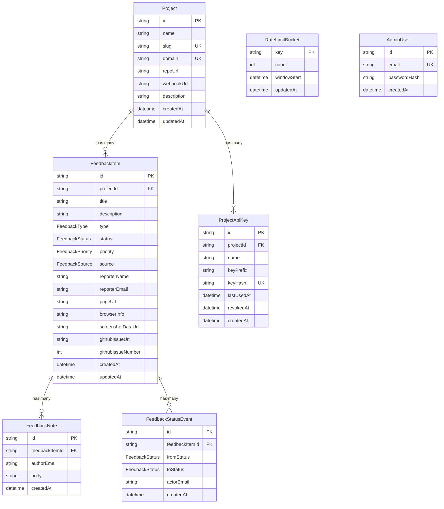

# Data Model & Migrations

The database schema is managed by **Prisma 6** (`prisma/schema.prisma`) on **PostgreSQL 16**. Every primary key (except `RateLimitBucket.key`) uses `cuid()`, and relational children cascade on parent deletion.

---

## Entity-Relationship Diagram

---

## Enums

| Enum | Values | Notes |
| --- | --- | --- |
| `FeedbackType` | `bug`, `improvement`, `feature`, `question` | Required on all feedback items |
| `FeedbackStatus` | `open`, `in_progress`, `resolved`, `closed` | Defaults to `open` |
| `FeedbackPriority` | `low`, `medium`, `high` | Nullable on `FeedbackItem` |
| `FeedbackSource` | `manual`, `public_form`, `extension`, `api` | Defaults to `manual` |

---

## Table Reference

### `Project`
- `slug` is generated by `lib/slug.ts` with numeric collision suffixes (`-1`, `-2`, ...).
- `domain` is normalized to a lowercase hostname (`lib/domain.ts`) and has a unique index when non-null.
- `webhookUrl` stores an optional Slack, Discord, or custom HTTP(S) webhook URL notified on public/extension/API submissions.

### `FeedbackItem`
- Indexed on `projectId` (`@@index([projectId])`) and cascades on `Project` deletion.
- Stores both the raw/formatted `description` and structured context columns (`pageUrl`, `browserInfo`, `screenshotDataUrl`).
- Tracks external promotion via `githubIssueUrl` and `githubIssueNumber`.

### `FeedbackNote` & `FeedbackStatusEvent`
- `FeedbackNote` stores private admin notes authored during triage (`authorEmail`, `body`).
- `FeedbackStatusEvent` records status transitions (`fromStatus`, `toStatus`, `actorEmail`) automatically whenever `PUT` or `PATCH /api/feedback/[id]` changes `status`.

### `ProjectApiKey` & `RateLimitBucket`
- `ProjectApiKey` stores `keyPrefix` (`btk_` + first 8 hex chars) for display and SHA-256 `keyHash` (`@unique`) for lookup. Keys support soft revocation via `revokedAt` and track `lastUsedAt`.
- `RateLimitBucket` persists IP-keyed rate-limit windows (`key`, `count`, `windowStart`) across server restarts and multiple instances.

### `AdminUser`
- Holds the single admin account seeded from `ADMIN_EMAIL` and `ADMIN_PASSWORD` by `prisma/seed.ts` (`bcrypt` cost 12).

---

## Migration History

| Migration | Purpose |
| --- | --- |
| `20260819130000_init_project` | Initial `Project` table |
| `20260819132000_add_feedback_item` | `FeedbackItem` table and enums |
| `20260819134500_add_admin_user` | `AdminUser` table |
| `20260819151500_add_project_domain` | Unique `Project.domain` column |
| `20261121140000_milestone3_capture_integrations` | `Project.webhookUrl` + `FeedbackItem` context/screenshot/GitHub columns |
| `20261121150000_milestone4_collaboration_ops` | `FeedbackNote`, `FeedbackStatusEvent`, `ProjectApiKey`, and `RateLimitBucket` |
