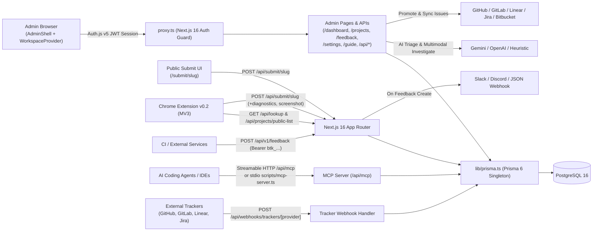

# System Overview & Security Model

Bug Tracking (`v0.2.0` — Workbench Platform) is a monolithic **Next.js 16.4.6 App Router** application (`React 19.3.1`, `TypeScript 5`, `Tailwind CSS v4`) backed by **PostgreSQL 16** via a shared Prisma 6 singleton (`lib/prisma.ts`, configured by `prisma.config.ts`), paired with a zero-build **Chrome Manifest V3** extension (`extension/`, `v0.2.0`) and a **built-in MCP server** (`/api/mcp` + `scripts/mcp-server.ts`).

---

## High-Level Topology

---

## Application Layers

| Layer | Responsibility | Key Files |
| --- | --- | --- |
| **Workbench Shell & Surfaces** | Collapsible Linear-style sidebar, Command Palette (`Cmd/Ctrl+K`), Page/Modal/Drawer Surface Engine, URL `?ticket=` sync, themes, layout widths | `components/admin-shell.tsx`, `components/workspace-provider.tsx`, `components/surface-shells.tsx`, `components/page-container.tsx` |
| **Routing & SSR Pages** | Server-rendered admin pages (`/dashboard`, `/feedback`, `/projects`, `/settings`, `/guide`) and public submission forms (`/submit/[slug]`) | `app/dashboard/**`, `app/projects/**`, `app/feedback/**`, `app/settings/**`, `app/guide/**`, `app/submit/[slug]/**` |
| **Route Handlers** | REST JSON/CSV APIs, Streamable HTTP MCP JSON-RPC 2.0 server, two-way tracker webhooks, and `/api/health` | `app/api/**` |
| **Next.js 16 Proxy Guard** | Replaces deprecated `middleware.ts`; redirects unauthenticated admin pages to `/login?callbackUrl=...` and rejects unauthenticated admin APIs with `401` | `proxy.ts` |
| **Domain & Security Helpers** | Auth guards, strict 6-state workflow, sequential ticket keys, canonical ticket links, query parser, rate limiting, API keys, workspace settings, dashboard stats, guided tours | `lib/auth.ts`, `lib/workflow.ts`, `lib/ticket-keys.ts`, `lib/ticket-links.ts`, `lib/feedback-query.ts`, `lib/rate-limit.ts`, `lib/api-keys.ts`, `lib/workspace-settings.ts`, `lib/dashboard-stats.ts`, `lib/tours.ts` |
| **Integrations & AI** | AI triage/duplicate detection, repo-aware multimodal AI investigation, multi-platform Git detection, 5 external issue trackers, outgoing webhooks | `lib/ai-triage.ts`, `lib/ai-investigate.ts`, `lib/git-platforms.ts`, `lib/trackers.ts`, `lib/github.ts`, `lib/notifications.ts` |
| **CLI & MCP Bridge** | Local stdio MCP bridge forwarding JSON-RPC to `/api/mcp`, demo data seeding, and JSON database snapshots | `scripts/mcp-server.ts`, `scripts/seed-demo.ts`, `scripts/backup-data.ts` |
| **Chrome Extension (`v0.2.0`)** | Zero-build MV3 popup + options page with `activeTab`, `scripting`, and `storage` permissions | `extension/manifest.json`, `extension/popup.js`, `extension/options.js` |

---

## Workbench Shell, Surface Engine & Appearance

### Collapsible Linear-Style `AdminShell` (`components/admin-shell.tsx`)
All authenticated admin routes render inside `AdminShell` wrapped by `WorkspaceProvider`:
- **Collapsible Left Sidebar:** Persists `sidebarCollapsed` to `WorkspaceSettings` (`PATCH /api/settings`) and provides quick links to **Dashboard**, **Inbox**, **Projects**, pinned **Saved Views**, **Guide**, **Settings**, a quick theme toggle, and the `v0.2.0` release badge (`lib/version.ts`).
- **Configurable Layout Width (`components/page-container.tsx`):** Controlled by `WorkspaceSettings.layoutWidth` with three options:
  - `full` — **Full (`100%`)** (default)
  - `wide` — **Wide (`1280px`)**
  - `narrow` — **Narrow (`1024px`)**

### `WorkspaceProvider` Surface Engine (`components/workspace-provider.tsx` & `components/surface-shells.tsx`)
`WorkspaceProvider` synchronizes `WorkspaceSettings` across the admin app and dynamically chooses how key workflows open:
- **Independent Presentation Modes (`page` | `modal` | `drawer`):**
  - **New Project:** defaults to `page` (`/projects/new`)
  - **New Feedback / Ticket:** defaults to `modal` (native `<dialog>`)
  - **Ticket Review:** defaults to `drawer` (slide-over review panel)
- **URL `?ticket=<id>` Deep-Link Sync:** Opening a ticket in drawer or modal mode updates `?ticket=<id>` in the URL without losing list filters, enabling shareable deep links and browser Back/Forward navigation.
- **Global Keyboard Shortcuts:**
  - `Cmd/Ctrl+K` — Open Command Palette (jump to projects, tickets, views, or actions)
  - `C` — Quick-create a new ticket in the configured surface
  - `J` / `K` — Step to the next / previous ticket inside the open Ticket Review Drawer
  - `Esc` — Close the active surface or dialog

### Dark Mode & 5 Accent Themes (`app/globals.css`)
- **Color Schemes (`ThemeMode`):** `system` (default), `light`, and `dark`, rendered with zero-FOUC SSR cookies (`LAYOUT_WIDTH_COOKIE`, `THEME_MODE_COOKIE`, `THEME_ACCENT_COOKIE` set by `PATCH /api/settings`), `<meta name="color-scheme" content="light dark">`, and live `prefers-color-scheme` sync.
- **Accent Palettes (`ThemeAccent`):** 5 CSS custom-property accent themes — `slate` (Linear default), `indigo`, `emerald`, `amber`, and `rose`.

### Tiptap v3 WYSIWYG ↔ GFM Markdown Pipeline (`components/markdown-editor.tsx`)
Ticket descriptions and internal admin notes use a pure-Markdown storage model paired with rich WYSIWYG editing:
- **Editing:** Tiptap v3 (`@tiptap/react`, `@tiptap/starter-kit` with built-in `link` configured directly on `StarterKit` to avoid duplicate extension warnings, `@tiptap/extension-task-list`, `@tiptap/extension-task-item`, `@tiptap/extension-placeholder`).
- **Roundtrip Conversion:** Incoming GFM Markdown is parsed to sanitized HTML (`marked` + `DOMPurify`), edited in Tiptap, and serialized back to clean GFM Markdown (`turndown`) before saving to PostgreSQL.
- **Safe Read Rendering:** Stored Markdown renders via `react-markdown` + `remark-gfm` + `rehype-sanitize`.

---

## Authentication & Access Boundaries

Bug Tracking enforces **defense-in-depth** authentication across the Next.js 16 proxy layer and every route handler:

1. **Next.js 16 Proxy Guard (`proxy.ts`):**
   - Replaces deprecated `middleware.ts` using the Next.js 16 `export async function proxy(request)` convention.
   - Matches admin pages (`/dashboard/:path*`, `/projects/:path*`, `/feedback/:path*`, `/settings/:path*`, `/guide/:path*`) and admin APIs (`/api/projects/:path*`, `/api/feedback/:path*`, `/api/settings/:path*`, `/api/dashboard/:path*`, `/api/labels/:path*`, `/api/views/:path*`).
   - Explicitly bypasses `/api/projects/public-list` so the Chrome extension fallback picker remains unauthenticated.
   - Verifies the JWT via `getToken()` (`next-auth/jwt`) with `AUTH_SECRET`: missing tokens return HTTP `401` `{ error: "Unauthorized" }` on API paths or redirect to `/login?callbackUrl=...` on page routes.
2. **Route Handler Guard (`lib/auth.ts`):**
   - Every protected admin API route calls `requireAdminSession()` (returns `{ email }` or `errorResponse`) or `requireAdminApiSession()`, guaranteeing `401` `{ error: "Unauthorized" }` even if invoked directly in tests or behind a misconfigured proxy.
   - `requireAdminSession()` extracts `session.user.email` to stamp `authorEmail` on `FeedbackNote`, `actorEmail` on `FeedbackStatusEvent`, and `createdByEmail` on `FeedbackLink`.
3. **Auth Provider (`lib/auth.ts`):**
   - Single-admin Auth.js v5 `Credentials` provider verifying trimmed/lowercased `email` and `bcryptjs` password hash (12 salt rounds seeded by `prisma/seed.ts`) against `AdminUser` with JWT sessions.
4. **Scoped Programmatic API Keys & MCP Auth (`lib/api-keys.ts`):**
   - `POST /api/v1/feedback` authenticates via `Authorization: Bearer btk_...` or `x-api-key: btk_...` against SHA-256 `keyHash` in `ProjectApiKey` (where `revokedAt IS NULL`).
   - `POST /api/mcp` accepts either a project-scoped `btk_*` Bearer/`x-api-key` token (scoping all tool calls to that single project) or an authenticated Admin session cookie (granting cross-project workspace access).
5. **Incoming Tracker Webhooks (`app/api/webhooks/trackers/[provider]/route.ts`):**
   - Bypasses session auth and verifies requests when `TRACKER_WEBHOOK_SECRET` is configured using timing-safe comparison against `x-webhook-secret`, GitHub `x-hub-signature-256` (HMAC-SHA256), GitLab `x-gitlab-token`, or Linear `linear-signature` (HMAC-SHA256).

---

## Public Intake Protections

Because `/submit/[slug]`, `/api/submit/[slug]`, `/api/lookup`, `/api/projects/public-list`, and `/api/health` are intentionally public:

- **Minimum Data Exposure:** `/api/lookup` returns only `{ found, slug, name }` (or `{ found: false }`), and `/api/projects/public-list` returns only `{ slug, name }`. Internal IDs, repository URLs, tracker configs, and webhook URLs are never exposed publicly.
- **Honeypot Field:** Public submissions with a non-empty `website` field immediately receive `{ ok: true }` (`200`) without writing to PostgreSQL.
- **Persistent Rate Limiting (`lib/rate-limit.ts`):** `POST /api/submit/[slug]` enforces 5 submissions per 10 minutes per client IP (`x-forwarded-for` / `x-real-ip`), persisted in the `RateLimitBucket` table in PostgreSQL (with an automatic in-memory fallback when mocked in unit tests).
- **Strict Payload Bounds:** Titles are capped at 200 chars, descriptions at 5,000 chars, page URLs at 2,000 chars, browser info at 500 chars, and screenshots must begin with `data:image/` and stay within 2,000,000 characters.
