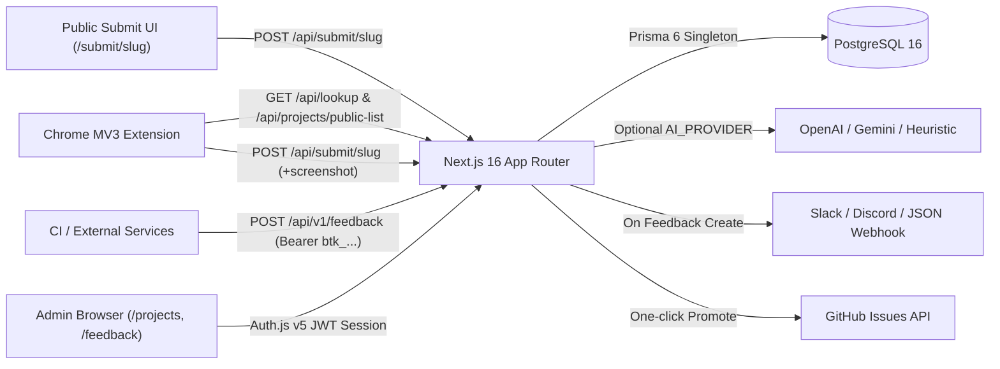

# System Overview & Security Model

Bug Tracking is a monolithic **Next.js 16 App Router** application backed by **PostgreSQL 16** via a shared Prisma singleton (`lib/prisma.ts`), paired with a standalone **Chrome Manifest V3** browser extension (`extension/`).

---

## High-Level Topology

---

## Application Layers

| Layer | Responsibility | Key Files |
| --- | --- | --- |
| **Routing & SSR Pages** | Server-rendered admin pages and public submission forms (`force-dynamic` on DB-backed pages) | `app/projects/**`, `app/feedback/**`, `app/submit/[slug]/**` |
| **Route Handlers** | REST-style JSON/CSV APIs for projects, feedback triage, AI triage, GitHub promotion, exports, and health | `app/api/**` |
| **Edge Middleware** | Redirects unauthenticated admin page requests to `/login` and rejects unauthenticated admin API calls with `401` | `middleware.ts` |
| **Domain & Security Helpers** | Auth helpers, domain normalization, slug generation, query parsing, rate limiting, API keys | `lib/auth.ts`, `lib/domain.ts`, `lib/slug.ts`, `lib/feedback-query.ts`, `lib/rate-limit.ts`, `lib/api-keys.ts` |
| **Integrations** | AI cleanup/duplicate detection, outgoing webhooks, GitHub issue creation | `lib/ai-triage.ts`, `lib/notifications.ts`, `lib/github.ts` |
| **Extension** | Zero-build MV3 popup + options page using `activeTab` and `storage` permissions | `extension/manifest.json`, `extension/popup.js`, `extension/options.js` |

---

## Authentication & Access Boundaries

Bug Tracking enforces **defense-in-depth** authentication across both middleware and route handlers:

1. **Middleware Guard (`middleware.ts`):**
   - Matches `/projects/:path*`, `/feedback/:path*`, `/api/projects/:path*`, and `/api/feedback/:path*`.
   - Explicitly bypasses `/api/projects/public-list` so the Chrome extension fallback picker remains unauthenticated.
   - Uses `getToken` (`next-auth/jwt`) with `AUTH_SECRET`: missing tokens return HTTP `401` on API paths or `307` redirect to `/login` on page routes.
2. **Route Handler Guard (`lib/auth.ts`):**
   - Every protected admin route calls `requireAdminApiSession()` or `requireAdminSession()` (which calls `auth()`), ensuring `401` `{ error: "Unauthorized" }` even if invoked directly in tests or behind misconfigured proxies.
   - `requireAdminSession()` also extracts `session.user.email` to stamp `authorEmail` on `FeedbackNote` and `actorEmail` on `FeedbackStatusEvent`.
3. **Auth Provider (`lib/auth.ts`):**
   - Single-admin `Credentials` provider verifying `email` (trimmed, lowercased) and `bcrypt` password hash (`12` rounds in `prisma/seed.ts`) against `AdminUser` with JWT sessions.
4. **Scoped Programmatic API Keys (`app/api/v1/feedback/route.ts`):**
   - Requests to `POST /api/v1/feedback` bypass Auth.js middleware and authenticate via `Authorization: Bearer <key>` or `x-api-key: <key>`.
   - Raw keys (`btk_<48 hex chars>`) are SHA-256 hashed (`lib/api-keys.ts`) and matched against active (`revokedAt IS NULL`) rows in `ProjectApiKey`.

---

## Public Intake Protections

Because `/submit/[slug]`, `/api/submit/[slug]`, `/api/lookup`, and `/api/projects/public-list` are intentionally public:

- **Minimum Data Exposure:** `/api/lookup` returns only `{ found, slug, name }` (or `{ found: false }`), and `/api/projects/public-list` returns only `{ slug, name }`. Internal IDs, repository URLs, and webhook URLs are never exposed publicly.
- **Honeypot Field:** Public submissions with a non-empty `website` field immediately receive `{ ok: true }` (`200`) without writing to PostgreSQL.
- **Persistent Rate Limiting (`lib/rate-limit.ts`):** `POST /api/submit/[slug]` enforces 5 submissions per 10 minutes per client IP (`x-forwarded-for` / `x-real-ip`), backed by the `RateLimitBucket` table in PostgreSQL (with an automatic in-memory fallback when Prisma bucket methods are mocked).
- **Strict Payload Bounds:** Titles are capped at 200 chars, descriptions at 5,000 chars, page URLs at 2,000 chars, browser info at 500 chars, and screenshots must begin with `data:image/` and stay within 2,000,000 characters.
