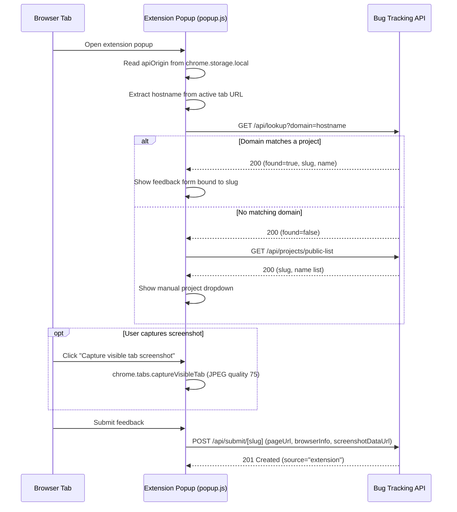

# Chrome Manifest V3 Extension

The browser extension lives in `extension/` as plain HTML, CSS, and JavaScript with **no bundler or build step**. It enables team members or external testers to report issues directly from any active tab without authenticating as an admin.

---

## Permissions & Files

| File | Purpose |
| --- | --- |
| `extension/manifest.json` | MV3 manifest declaring `activeTab` and `storage` permissions plus `host_permissions` for `http://localhost:3000/*` and your production origin |
| `extension/popup.html` / `popup.js` / `popup.css` | Popup UI for site detection, manual fallback selection, screenshot capture, and feedback submission |
| `extension/options.html` / `options.js` / `options.css` | Options page persisting `apiOrigin` in `chrome.storage.local` |

---

## Site Detection & Submission Flow

---

## Domain Normalization (`lib/domain.ts`)

Both project creation/update (`POST /api/projects`, `PUT /api/projects/[id]`) and extension lookup (`GET /api/lookup?domain=...`) normalize domains via `normalizeDomain()`:

- Trims whitespace and lowercases the input.
- Parses full URLs (`https://APP.Example.com:8443/path` -> `app.example.com`) using the standard `URL` parser, stripping ports, paths, query strings, and trailing dots.
- Falls back to safe string stripping if an invalid URL fragment is passed.

---

## Visible-Tab Screenshot & Context Capture

- Clicking **Capture visible tab screenshot** in `popup.html` calls `chrome.tabs.captureVisibleTab(null, { format: "jpeg", quality: 75 })`, which works under MV3's existing `activeTab` permission.
- The extension renders an inline preview with **Retake screenshot** and **Remove screenshot** controls.
- On submit, `popup.js` sends `pageUrl`, `browserInfo` (`navigator.userAgent`), and optional `screenshotDataUrl` to `POST /api/submit/[slug]`.
- The server stores structured columns (`pageUrl`, `browserInfo`, `screenshotDataUrl`), appends the delimited `---\nSubmitted via extension` block to `description` when `pageUrl`/`browserInfo` are provided, and sets `source: "extension"`.
