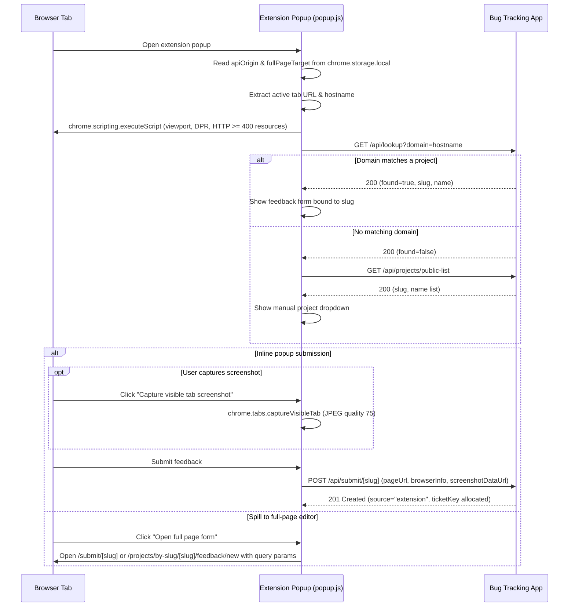

# Chrome Manifest V3 Extension (`v0.2.0`)

The browser extension lives in `extension/` as plain HTML, CSS, and JavaScript with **no bundler or build step**. Version `0.2.0` adds automatic active-tab diagnostics (viewport, DPR, and recent failed HTTP requests) and a configurable **"Open full page form"** handoff alongside domain auto-detection and visible-tab screenshot capture.

---

## Permissions & Files

| File | Purpose |
| --- | --- |
| `extension/manifest.json` | MV3 manifest (`version: "0.2.0"`) declaring `activeTab`, `scripting`, and `storage` permissions plus `host_permissions` for `http://localhost:3000/*` and your production origin |
| `extension/popup.html` / `popup.js` / `popup.css` | Popup UI for automatic diagnostics collection, site detection, manual fallback selection, visible-tab screenshot capture, inline submission, and full-page form handoff |
| `extension/options.html` / `options.js` / `options.css` | Options page persisting `apiOrigin` and `fullPageTarget` (`public` vs `admin`) in `chrome.storage.local` |

---

## Site Detection, Diagnostics & Submission Flow

---

## Automatic Page Diagnostics (`scripting` Permission)

When the popup initializes, `collectTabDiagnostics(tabId)` uses `chrome.scripting.executeScript` on the active tab to inspect live runtime context without needing persistent content scripts:

- **Viewport & DPR:** Captures `window.innerWidth x window.innerHeight @devicePixelRatio` (for example, `1440x900 @2x`).
- **Failed HTTP Resources:** Inspects `performance.getEntriesByType("resource")`, filters entries where `responseStatus >= 400`, takes the 5 most recent failures, and formats each as `<status> <url-prefix>`.
- **Graceful Fallback:** Combines `navigator.userAgent`, viewport, and failed HTTP entries into a ` | `-delimited `browserInfo` string capped at 490 characters. On restricted browser pages (such as `chrome://` tabs) where script injection is disallowed, it silently falls back to `navigator.userAgent`.

---

## Visible-Tab Screenshot Capture

- Clicking **Capture visible tab screenshot** calls `chrome.tabs.captureVisibleTab(null, { format: "jpeg", quality: 75 })`, covered by MV3's `activeTab` permission.
- The popup renders an inline image preview with **Retake screenshot** and **Remove screenshot** controls.
- On submit, `popup.js` posts `pageUrl`, `browserInfo` (diagnostics summary), and optional `screenshotDataUrl` to `POST /api/submit/[slug]`.
- The server stores structured columns (`pageUrl`, `browserInfo`, `screenshotDataUrl`), allocates the project's next `ticketKey`, appends the delimited `---\nSubmitted via extension` block to `description`, and records `source: "extension"`.

---

## Options Toggle & "Open Full Page Form" Flow

For complex bug reports that need Markdown formatting, tables, or multiple code snippets, click **Open full page form** inside the popup:

1. **Configurable Target (`options.html` / `options.js`):** The extension options page saves `fullPageTarget` in `chrome.storage.local` alongside `apiOrigin`:
   - **`public` (default):** Opens `${apiOrigin}/submit/${slug}` — the unauthenticated public submission form.
   - **`admin`:** Opens `${apiOrigin}/projects/by-slug/${slug}/feedback/new` — a slug-based redirect route that resolves the project ID and forwards to `/projects/[id]/feedback/new` (the authenticated Tiptap WYSIWYG Markdown editor).
2. **Pre-Filled Diagnostic Context:** `popup.js` attaches `pageUrl`, `browserInfo` (viewport/DPR/failed HTTP diagnostics), and `source=extension` as URL query parameters. Both `/submit/[slug]` and `/projects/by-slug/[slug]/feedback/new` preserve and pre-populate those diagnostics automatically.

---

## Domain Normalization (`lib/domain.ts`)

Both project creation/update (`POST /api/projects`, `PUT /api/projects/[id]`) and extension lookup (`GET /api/lookup?domain=...`) normalize hostnames via `normalizeDomain()`:

- Trims whitespace and lowercases the input.
- Parses full URLs (`https://APP.Example.com:8443/path` -> `app.example.com`) using the standard `URL` parser, stripping ports, paths, query strings, and trailing dots.
- Falls back to safe string stripping if an invalid URL fragment is passed.
