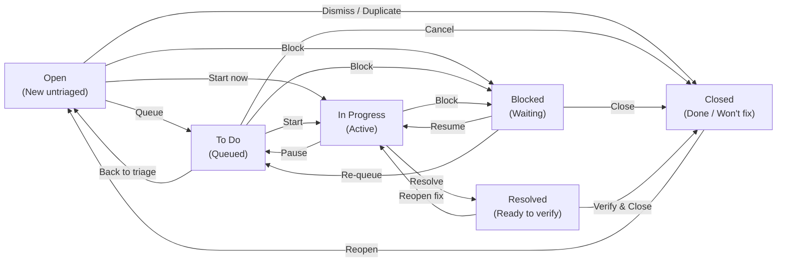

# Daily Triage, Workbench Views & Collaboration

Version `v0.2.0` upgrades Bug Tracking into a full Linear/Jira-inspired **Workbench Platform** with a strict 6-state workflow, sequential ticket keys, four switchable ticket layouts, a URL-synced Review Drawer with keyboard stepping, Bulk Actions, Linked Tickets, Labels, Saved Views, Tiptap Markdown editing, analytics dashboards, interactive guided tours, and type-to-confirm Danger Zone safety.

---

## Strict 6-State Workflow Engine (`lib/workflow.ts`)

Every status transition is validated identically across inline dropdowns, Kanban drag-and-drop, bulk actions, REST APIs (`PUT`/`PATCH /api/feedback/[id]`, `POST /api/feedback/bulk`), and the MCP `update_ticket` tool. Illegal status jumps are rejected with HTTP `400` and an error message listing the allowed next statuses (`getTransitionErrorMessage()`).

### Transition Matrix

| From Status | Allowed Next Statuses | Transition Intent |
| --- | --- | --- |
| **Open** (`open`) | `todo`, `in_progress`, `blocked`, `closed` | Queue, start immediately, block on dependency, or dismiss/duplicate |
| **To Do** (`todo`) | `in_progress`, `blocked`, `open`, `closed` | Start work, block, return to triage, or cancel |
| **In Progress** (`in_progress`) | `resolved`, `blocked`, `todo` | Ship fix (`resolved`), mark blocked, or pause back to queue |
| **Blocked** (`blocked`) | `in_progress`, `todo`, `closed` | Resume work, re-queue, or close |
| **Resolved** (`resolved`) | `closed`, `in_progress` | Verify & close, or reopen active fix |
| **Closed** (`closed`) | `open` | Reopen into triage |

### Workflow State Graph

Inside ticket detail views, `/dashboard`, and `/guide`, `components/workflow-graph.tsx` renders an interactive orthogonal linear-line SVG diagram (`WorkflowGraph`) highlighting the active status and valid outgoing transitions:

---

## Triage Order, Urgent Priority & Sequential Ticket Keys

- **Consistent Triage Order:** All creation forms, filter bars, inline controls, and detail panels present triage fields in the order **`Type -> Priority -> Status`**.
- **Urgent Priority:** `FeedbackPriority` supports `low`, `medium`, `high`, and `urgent` (plus unset/`null`). The PostgreSQL enum is ordered `low < medium < high < urgent` so `sort=priority_desc` places `urgent` tickets first with `nulls: "last"`.
- **Sequential Ticket Keys (`lib/ticket-keys.ts`):** Every project owns a unique `keyPrefix` (derived via `deriveKeyPrefix()` or customized in `/projects/[id]`, e.g., `WEB`, `PAY`) and an atomic `nextSequence` counter. `allocateNextTicketKey()` generates human-readable keys (`WEB-1`, `PAY-42`) on every creation path (manual UI, public form, extension, API key, and MCP).

---

## Ticket Views, Review Drawer & Rapid Keyboard Triage

Both the **Global Inbox (`/feedback`)** and **Project Ticket Board (`/projects/[id]/feedback`)** support four switchable views (with the workspace default stored in `WorkspaceSettings.defaultTicketView`):

| View Mode (`TicketViewMode`) | Label | Best For |
| --- | --- | --- |
| `list_full` | **Full Scroll List** (default) | Dense triage across long backlogs with inline controls and multi-select checkboxes |
| `list_fixed` | **Fixed Height List** | Viewport-locked scrollable table inside desktop monitors |
| `grid` | **Card Grid** | Visual triage with attached screenshot thumbnail previews |
| `kanban` | **Kanban Board** (`@dnd-kit/core`) | Column-by-column status movement with live drop validation against `WORKFLOW_TRANSITIONS` |

### URL-Synced Review Drawer & Shortcuts
- **Flexible Surfaces:** In `/settings`, choose `Page`, `Modal`, or `Drawer` independently for **New Project** (`page` default), **New Feedback** (`modal` default), and **Ticket Review** (`drawer` default).
- **URL Deep Linking (`?ticket=<id>`):** Clicking a ticket in drawer or modal mode syncs `?ticket=<id>` to the browser URL so links can be shared directly and Back/Forward history works naturally.
- **Keyboard Triage:**
  - `Cmd/Ctrl+K` — Command Palette across projects, tickets, views, and navigation
  - `C` — Quick-create ticket in the configured surface
  - `J` / `K` — Step to the next / previous ticket inside the open Review Drawer without closing it
  - `Esc` — Dismiss active drawer, modal, or palette

---

## Multi-Select Bulk Actions (`POST /api/feedback/bulk`)

In List and Grid views, select multiple tickets (up to 100 unique IDs per request) to reveal the floating bulk action toolbar:

- **Bulk Priority:** Set `urgent`, `high`, `medium`, `low`, or clear priority (`null`).
- **Workflow-Safe Bulk Status:** Transitions only tickets whose current status permits the target status under `canTransitionStatus()`, records a `FeedbackStatusEvent` for every transitioned ticket inside a Prisma transaction, and reports `{ updated, skipped }` so illegal transitions are safely skipped rather than breaking workflow integrity.
- **Bulk Add Label:** Attaches a global or project label to all selected tickets (`skipDuplicates: true`).
- **Bulk Delete:** Protected by the type-to-confirm Danger Zone modal (`DELETE`).

---

## Linked Tickets, Labels & Saved Views

### Typed Ticket Relationships (`FeedbackLink` & `lib/ticket-links.ts`)
Link any two tickets across or within projects from the Ticket Detail Workspace (`/feedback/[id]`) or Review Drawer. Edges are stored canonically in `FeedbackLink` and rendered symmetrically with inverse labels:

| Canonical Relation (`FeedbackLinkType`) | Outgoing Label | Inverse Label | Triage Helpers |
| --- | --- | --- | --- |
| `blocks` | `blocks` | `is blocked by` | Offers a 1-click **"Set status to Blocked"** action when blocked by another ticket |
| `causes` | `causes` | `is caused by` | Trace root regressions to downstream symptoms |
| `duplicates` | `duplicates` | `is duplicated by` | Pairs with 1-click **"Link dup"** inside `AiTriagePanel` |
| `parent_of` | `parent of` | `subtask of` | Group multi-part work under an epic or parent ticket |
| `relates_to` | `relates to` | `relates to` | Symmetric non-directional association |

### Colored Labels (`Label` & `FeedbackLabel`)
- Create global labels (`projectId = null`) or project-scoped labels (`projectId`) with color tokens via `/projects/[id]` or `/api/labels`.
- Filter the Global Inbox and Project Boards by `?labelId=<id>` and update ticket labels atomically via `PUT /api/feedback/[id]/labels`.

### Pinned Saved Views (`SavedView`)
- Click **Save View** on any filtered inbox or project board to persist the current filter object (`q`, `projectId`, `status`, `type`, `priority`, `source`, `labelId`, `sort`) via `POST /api/views`.
- Saved views appear directly in the collapsible `AdminShell` left sidebar for one-click access.

---

## Rich Text Editing, Notes & Status Audit Trail

- **Tiptap v3 WYSIWYG Markdown (`components/markdown-editor.tsx`):** Both ticket descriptions and internal admin notes use Tiptap v3 (`StarterKit` with built-in `link`, task lists, headings, code blocks, lists) while storing pure GFM Markdown in PostgreSQL via `marked` + `DOMPurify` (Markdown to HTML) and `turndown` (HTML to Markdown). Read views render safely with `react-markdown`, `remark-gfm`, and `rehype-sanitize`.
- **Automatic Status Audit Trail:** Every status change across `PUT`/`PATCH /api/feedback/[id]`, `POST /api/feedback/bulk`, and MCP `update_ticket` writes a `FeedbackStatusEvent` (`fromStatus`, `toStatus`, `actorEmail`).
- **Internal Admin Notes:** `components/feedback-notes-panel.tsx` loads `GET /api/feedback/[id]/notes` (`notes` + `statusEvents`) and appends new Markdown notes (`1..5000` chars) via `POST /api/feedback/[id]/notes`. Incoming tracker webhooks and MCP clients also append attributed notes (`webhook:<provider>`, `mcp:<keyName>`).

---

## Search, Filtering, Sorting & Pagination (`lib/feedback-query.ts`)

SSR pages and API endpoints (`GET /api/feedback`, `GET /api/projects/[id]/feedback`, `GET /api/feedback/export`) share `parseFeedbackQueryParams()`:

| Parameter | Behavior | Validation |
| --- | --- | --- |
| `q` | Case-insensitive `OR` substring search across `ticketKey`, `title`, `description`, `reporterName`, and `reporterEmail` | Trimmed string |
| `projectId` | Scopes results to a single project (fixed by route param in `/projects/[id]/feedback`) | Optional string |
| `status` | Filters by `open`, `todo`, `in_progress`, `blocked`, `resolved`, or `closed` | `400` on invalid enum |
| `type` | Filters by `bug`, `improvement`, `feature`, or `question` | `400` on invalid enum |
| `priority` | Filters by `low`, `medium`, `high`, `urgent`, or `none` (`priority IS NULL`) | `400` on invalid value |
| `source` | Filters by `manual`, `public_form`, `extension`, or `api` | `400` on invalid enum |
| `labelId` | Filters tickets tagged with the specified `Label.id` | Optional string |
| `sort` | `newest` (`createdAt desc`), `oldest` (`createdAt asc`), `updated` (`updatedAt desc`), `priority_desc` (`urgent` first, `nulls: "last"`), `priority_asc` (`nulls: "last"`) | `400` on invalid option |
| `page` / `pageSize` | Defaults to `page=1`, `pageSize=20`; `pageSize` clamped to `100` | Positive integers only (`400` otherwise) |

---

## Dashboards, Guided Tours, Settings, Guide & Danger Zone

- **Analytics Dashboards (`/dashboard` & `/projects/[id]/dashboard`):** Powered by `GET /api/dashboard` (`lib/dashboard-stats.ts`) and `recharts`, displaying KPI cards, status/priority/type breakdowns, 30-day inflow vs. resolution trends, recent activity, project health leaderboards, and the interactive `WorkflowGraph`.
- **Interactive Product Tours (`driver.js` & `lib/tours.ts`):** Context-aware guided tours walk admins through the workbench shell, triage views, and ticket workspace. Completed tour IDs persist in `WorkspaceSettings.completedTours` and can be reset in `/settings` or re-launched on demand from `/guide`.
- **Workspace Settings (`/settings`):** Persists Layout Width (`Full 100%` / `Wide 1280px` / `Narrow 1024px`), Default Ticket View, Surface Modes (`New Project`, `New Feedback`, `Ticket Review`), Dark/Light/System mode + 5 Accent Themes (`slate`, `indigo`, `emerald`, `amber`, `rose`), Guided Tour reset, MCP endpoint quick-copy, and the `v0.2.0` App Version card.
- **Built-In Guideline & Knowledge Hub (`/guide`):** In-app reference documenting the strict workflow SVG diagram, keyboard shortcuts, Chrome Extension setup, External Trackers & Webhooks, MCP configuration snippets, and one-click `driver.js` tour launchers.
- **Type-to-Confirm Danger Zone (`components/confirm-danger-modal.tsx`):** Destructive actions (Delete Project, Delete Ticket, Bulk Delete, API Key revocation) open a native `<dialog>` with `autofocus` on **Cancel** and keep the destructive confirm button disabled until the admin types the exact project slug, ticket key, or `DELETE`.

---

## Filtered CSV & JSON Export

Both `/feedback` and `/projects/[id]/feedback` expose **Export CSV** and **Export JSON** links to `GET /api/feedback/export` preserving all active filters (`q`, `projectId`, `status`, `type`, `priority`, `source`, `labelId`, `sort`):

- Exports up to `5,000` matching items.
- **CSV (`format=csv`):** RFC-4180 escaped `feedback-export.csv` covering `id`, `projectName`, `projectSlug`, `title`, `description`, `type`, `status`, `priority`, `source`, `reporterName`, `reporterEmail`, `pageUrl`, `browserInfo`, `githubIssueUrl`, `createdAt`, and `updatedAt`.
- **JSON (`format=json`):** Downloadable `feedback-export.json` containing `{ exportedAt, items }`.
