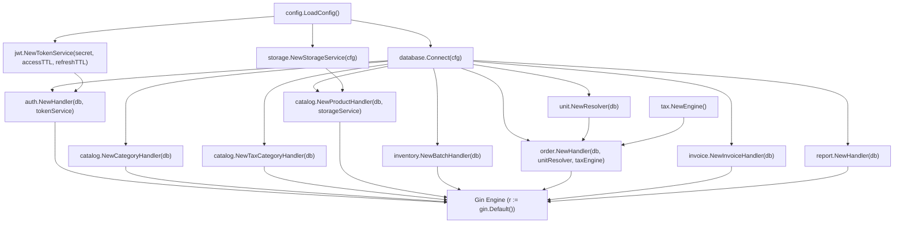
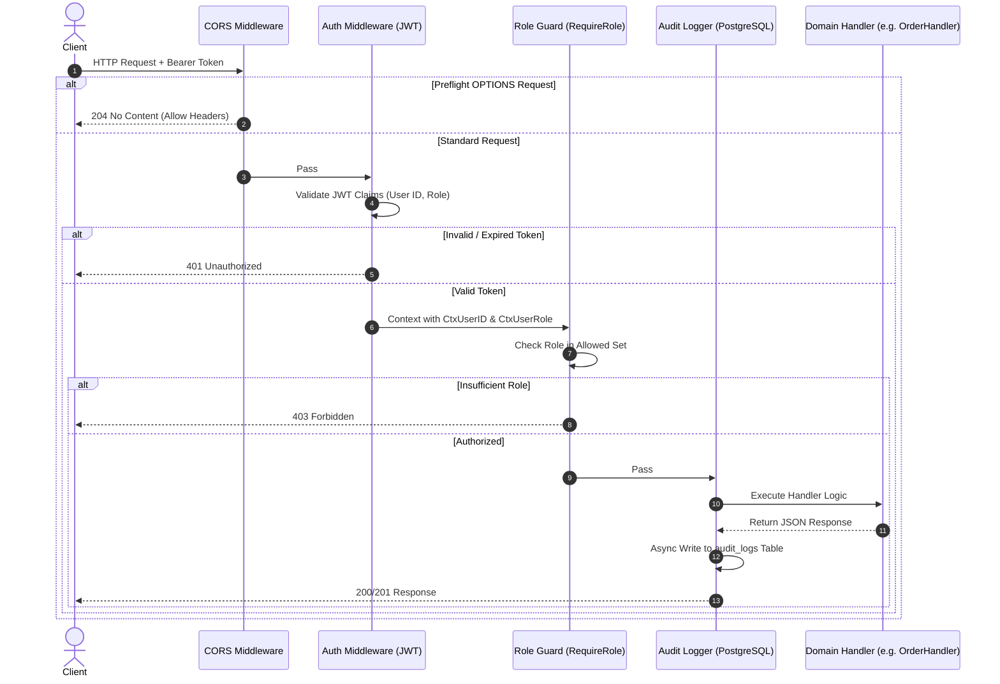

# Backend Architecture (Go 1.23)

The backend service (`sales-api`) is written in **Go 1.23** using the **Gin Web Framework** and **GORM**. It provides a compiled, high-performance RESTful API with low memory overhead, making it ideal for edge execution on modest local retail workstations or WSL2 environments.

---

## 1. Directory Structure & Modular Layout

The backend adopts clean architectural layering with explicit separation of entrypoints (`cmd/`), internal business domain modules (`internal/`), shared reusable packages (`pkg/`), and SQL migrations (`migrations/`):

```text
backend/
├── cmd/
│   ├── api/
│   │   └── main.go           # Application entrypoint & dependency injection wireup
│   ├── migrate/
│   │   └── main.go           # Database migration CLI executable
│   └── seed/
│       └── main.go           # Database seeding CLI executable
├── internal/
│   ├── auth/                 # Login, token refresh, /me profile, bcrypt password hashing
│   ├── catalog/              # Products, categories, tax categories, MinIO image upload
│   ├── config/               # Environment variable parser (.env loader via godotenv)
│   ├── database/             # PostgreSQL connection lifecycle, connection pooling
│   ├── inventory/            # Product batch management, FIFO allocation, expiry alerts
│   ├── invoice/              # Native Maroto PDF generator with embedded UTF-8 Roboto TTF
│   ├── middleware/           # CORS, JWT authentication, RBAC authorization, audit logging
│   ├── models/               # GORM database entities and domain types
│   ├── order/                # Order creation, wholesale price checks, tax snapshotting
│   ├── report/               # Daily, monthly, and Vietnamese tax settlement reports, Excel export
│   ├── seed/                 # Comprehensive seed logic (users, categories, products, batches)
│   ├── storage/              # MinIO S3 client wrapper for object upload and retrieval
│   └── tax/                  # Vietnamese VAT and PIT tax calculation engine
├── migrations/
│   ├── 001_init_schema.up.sql    # Forward DDL schema migration
│   ├── 001_init_schema.down.sql  # Reversal DDL schema migration
│   └── migrations.go             # Embedded migrations filesystem
├── pkg/
│   ├── jwt/                  # HMAC-SHA256 JWT token generation and validation
│   ├── money/                # Zero-float64 int64 VND money arithmetic and cash rounding
│   └── unit/                 # Product unit conversion resolver and pricing calculator
├── go.mod
└── go.sum
```

---

## 2. Dependency Injection & Server Lifecycle (`cmd/api/main.go`)

The backend avoids global singletons by constructing dependencies in `main.go` and passing them via constructors into handler structs:



### Handler Construction Pattern
Each domain handler encapsulates its required dependencies:
```go
type Handler struct {
    db           *gorm.DB
    unitResolver unit.Resolver
    taxEngine    tax.Engine
}

func NewHandler(db *gorm.DB, unitResolver unit.Resolver, taxEngine tax.Engine) *Handler {
    return &Handler{
        db:           db,
        unitResolver: unitResolver,
        taxEngine:    taxEngine,
    }
}
```

---

## 3. Middleware Execution Pipeline

Incoming HTTP requests pass through an ordered middleware chain before reaching route handlers:



### 3.1 CORS Middleware (`internal/middleware/cors.go`)
Configures `Access-Control-Allow-Origin`, `Access-Control-Allow-Methods` (GET, POST, PUT, DELETE, OPTIONS), and `Access-Control-Allow-Headers` (Authorization, Content-Type).

### 3.2 JWT Authentication Middleware (`internal/middleware/auth.go`)
- Extracts the token from `Authorization: Bearer <token>`.
- Validates the cryptographic signature (HMAC-SHA256) and expiration timestamp.
- Injects `user_id` and `role` into the Gin context (`c.Set(CtxUserID, ...)` and `c.Set(CtxUserRole, ...)`).

### 3.3 Role-Based Access Control (`internal/middleware/rbac.go`)
Enforces authorization rules based on user roles (`owner`, `cashier`, `viewer`):
```go
func RequireRole(roles ...string) gin.HandlerFunc {
    return func(c *gin.Context) {
        roleVal, exists := c.Get(CtxUserRole)
        // Checks if current role matches allowed roles...
    }
}
```

### 3.4 Audit Logging Middleware (`internal/middleware/audit.go`)
Captures mutating HTTP actions (POST, PUT, DELETE) and records the acting user ID, endpoint, method, and payload into the PostgreSQL `audit_logs` table for compliance and security auditing.

---

## 4. Database Connection Management (`internal/database/db.go`)

GORM is configured with PostgreSQL connection pooling parameters:
- **Max Open Connections:** 25
- **Max Idle Connections:** 10
- **Connection Max Lifetime:** 5 minutes
- **Prepared Statement Caching:** Enabled for query performance

---

## 5. Clean Concurrency & Thread Safety
- Handlers are stateless and safe for concurrent Gin goroutine execution.
- All transactional database mutations (e.g., placing an order, decrementing inventory, creating line snapshots) execute inside explicit GORM database transactions (`db.Transaction(func(tx *gorm.DB) error { ... })`).
- MinIO upload and PDF generation are non-blocking and streamed directly to HTTP clients using chunked buffers.
