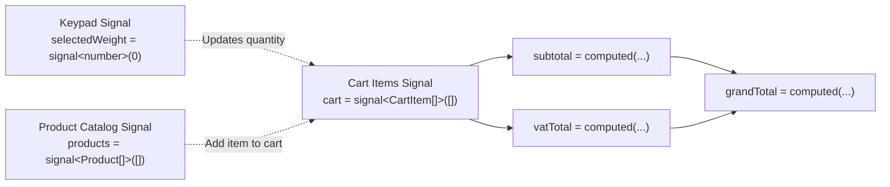

# Frontend Architecture (Angular 20)

The user interface is an enterprise Single Page Application (SPA) built with **Angular 20**, utilizing **Standalone Components**, **Angular Signals** for reactive state management, and a custom **WCAG AAA Accessible Theme**.

---

## 1. Directory Structure

```text
frontend/src/
├── app/
│   ├── app.component.ts         # Root shell: accessible header, tab navigation, logout
│   ├── app.config.ts            # Application providers (Router, HttpClient, Interceptors)
│   ├── app.routes.ts            # Route definitions, lazy loading, and AuthGuard protection
│   ├── core/                    # Singleton services, models, guards, interceptors
│   │   ├── auth.guard.ts        # Route guard verifying login status and role permissions
│   │   ├── auth.interceptor.ts  # HTTP Interceptor: injects Bearer token & handles 401 refresh
│   │   ├── auth.service.ts      # Authentication state machine using Angular Signals
│   │   ├── models.ts            # TypeScript interfaces matching backend models
│   │   ├── order.service.ts     # Order creation, order history, PDF download trigger
│   │   ├── product.service.ts   # Product catalog & category lookups
│   │   └── report.service.ts    # Daily/monthly sales analytics & Excel (.xlsx) downloads
│   ├── features/                # Domain-specific UI screens
│   │   ├── auth/
│   │   │   └── login.component.ts       # Accessible login with 1-tap sample credentials
│   │   ├── sell/
│   │   │   └── sell.component.ts        # Primary POS sell screen: search, cart, keypad, modal
│   │   ├── inventory/
│   │   │   └── inventory.component.ts   # Product units catalog & batch expiry alerts
│   │   └── reports/
│   │       └── reports.component.ts     # Daily/monthly revenue & Vietnamese tax summary
│   └── shared/                  # Reusable accessible UI components
├── assets/
│   └── i18n/
│       └── vi.json              # Vietnamese localization dictionary
├── environments/
│   └── environment.ts           # API URL configurations (http://localhost:8080/api/v1)
├── theme/
│   ├── _tokens.scss             # Design token CSS variables
│   ├── theme.scss               # High-contrast WCAG AAA theme rules
│   └── tokens.json              # Design token source definition
├── index.html                   # HTML5 shell with viewport and Roboto font imports
├── main.ts                      # Browser bootstrapping
└── styles.css                   # Global styles & accessibility reset
```

---

## 2. Component Hierarchy & Navigation Flow

The application restricts navigation to strictly three primary functional tabs to minimize confusion for elderly store operators:

```mermaid
graph TD
    AppShell["AppComponent (Root Shell)"]
    NavHeader["Accessible Header (≥ 18px Font)<br/>- Store Brand<br/>- Active Tab Indicator<br/>- Cashier Identity Badge<br/>- High-Contrast Logout Button"]
    
    LoginScreen["LoginComponent (/auth/login)<br/>- High contrast inputs<br/>- 1-Tap Sample Account Buttons"]
    SellScreen["SellComponent (/sell)<br/>- Category chips<br/>- 150×150px Product cards<br/>- Numeric keypad modal<br/>- 96px Action buttons<br/>- Live mixed-VAT cart"]
    InventoryScreen["InventoryComponent (/inventory)<br/>- Unit conversion tables<br/>- Batch expiry badges<br/>- FIFO allocation alert"]
    ReportsScreen["ReportsComponent (/reports)<br/>- Daily revenue summary<br/>- Monthly revenue progress<br/>- 2025/2026 Tax settlement (VAT + PIT)<br/>- 1-Click Excel export"]

    AppShell --> NavHeader
    AppShell --> RouterOutlet["<router-outlet>"]
    
    RouterOutlet -->|Unauthenticated| LoginScreen
    RouterOutlet -->|Authenticated (Bán hàng)| SellScreen
    RouterOutlet -->|Authenticated (Kho hàng)| InventoryScreen
    RouterOutlet -->|Authenticated (Báo cáo)| ReportsScreen
```

---

## 3. Reactive State Architecture with Angular Signals

Instead of heavy RxJS event piping or boilerplate state libraries, the frontend uses native **Angular Signals** for local and shared state:



### Signal Computation Example
```typescript
readonly cart = signal<CartItem[]>([]);

readonly subtotal = computed(() =>
  this.cart().reduce((sum, item) => sum + item.unitPrice * item.quantity, 0)
);

readonly vatTotal = computed(() =>
  this.cart().reduce((sum, item) => {
    const lineTotal = item.unitPrice * item.quantity;
    return sum + Math.round((lineTotal * item.vatRate) / 100);
  }, 0)
);

readonly grandTotal = computed(() => {
  const raw = this.subtotal() + this.vatTotal();
  // Round to nearest 100 VND for cash payment
  return Math.round(raw / 100) * 100;
});
```

---

## 4. HTTP Interceptors & Route Guards

### 4.1 Authentication Guard (`core/auth.guard.ts`)
Checks if a valid JWT is present in `localStorage`. If unauthenticated or expired, it redirects the browser to `/auth/login`.

### 4.2 HTTP Interceptor (`core/auth.interceptor.ts`)
- Automatically attaches the `Authorization: Bearer <token>` header to all outgoing requests toward `/api/v1`.
- Intercepts `401 Unauthorized` responses and triggers an asynchronous token refresh via `/auth/refresh`.
- If refresh fails, it clears credentials and routes the user back to the login screen.

---

## 5. Elderly Accessibility (WCAG AAA) Implementation

1. **Root Typography:** Base `rem` scale mapped so that all body fonts render at ≥ 18px.
2. **Interactive Targets:** Every clickable card, button, and tab measures at least 48× 48px.
3. **Primary Action Buttons:** "HỦY ĐƠN" (Cancel) and "THANH TOÁN" (Checkout) are hardcoded with a height of **96px** and bold 24px text to allow effortless operation on touchscreen tablets.
4. **Color Contrast:** All color pairs have been verified via axe-core to provide ≥ 7:1 contrast against their backgrounds (WCAG AAA).
