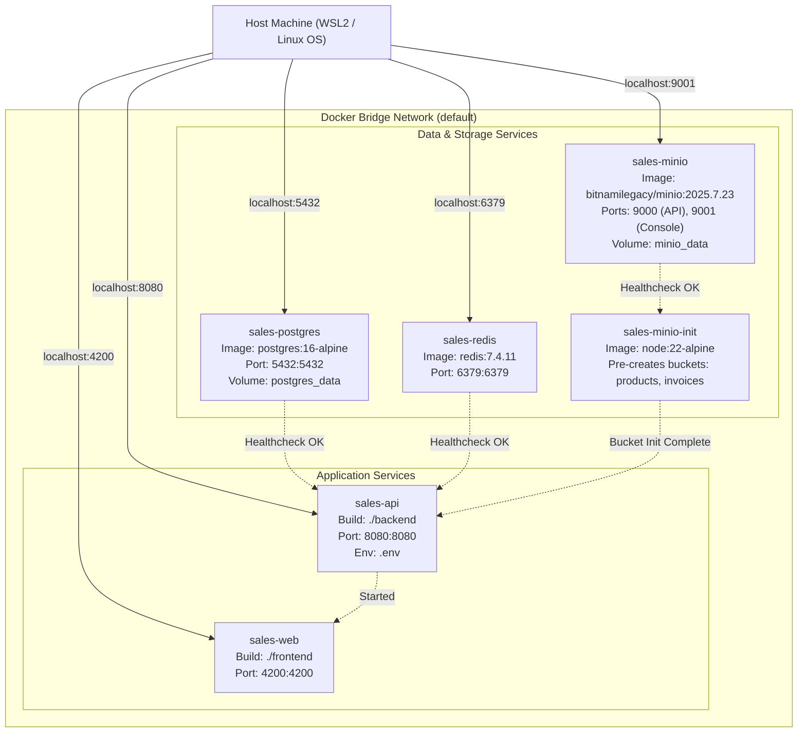

# Infrastructure & Docker Architecture

The application is deployed as a multi-container stack orchestrated via **Docker Compose**. This ensures identical environments across development, testing, and edge retail deployments on local WSL2 or Ubuntu Linux PCs.

---

## 1. Container Topology & Port Allocations



---

## 2. Service Specifications

### 2.1 `sales-postgres` (PostgreSQL 16)
- **Base Image:** `postgres:16-alpine`
- **Database:** `salesdb`
- **Default User:** `sales`
- **Port:** `5432`
- **Persistent Volume:** `postgres_data` mapped to `/var/lib/postgresql/data`
- **Healthcheck:**
  ```yaml
  test: ["CMD-SHELL", "pg_isready -U sales -d salesdb"]
  interval: 3s
  timeout: 3s
  retries: 10
  ```

### 2.2 `sales-redis` (Redis 7.4)
- **Base Image:** `redis:7.4.11`
- **Port:** `6379`
- **Healthcheck:**
  ```yaml
  test: ["CMD", "redis-cli", "ping"]
  interval: 3s
  timeout: 3s
  retries: 10
  ```

### 2.3 `sales-minio` (MinIO S3 Compatible Object Store)
- **Base Image:** `bitnamilegacy/minio:2025.7.23`
- **API Port:** `9000` (Used by backend S3 client)
- **Console Port:** `9001` (Web UI for browsing buckets)
- **Root Credentials:** `minioadmin` / `minioadmin`
- **Default Buckets:** `products` (images) and `invoices` (PDF archives)
- **Persistent Volume:** `minio_data` mapped to `/bitnami/minio/data`
- **Healthcheck:**
  ```yaml
  test: ["CMD-SHELL", "curl -f http://localhost:9000/minio/health/live || exit 1"]
  interval: 3s
  timeout: 3s
  retries: 10
  ```

### 2.4 `sales-api` (Go 1.23 REST API Service)
- **Build Context:** `./backend` (Multi-stage or development Dockerfile based on `golang:1.23-alpine`)
- **Port:** `8080`
- **Internal Environment Variables:**
  - `POSTGRES_HOST=postgres`
  - `REDIS_HOST=redis`
  - `MINIO_ENDPOINT=minio:9000`
- **Startup Dependencies:** Boots strictly after `postgres` and `redis` are healthy, and `minio-init` completes.

### 2.5 `sales-web` (Angular 20 Frontend Shell)
- **Build Context:** `./frontend` (Based on `node:22-alpine`)
- **Port:** `4200`
- **Startup Dependencies:** Boots after `sales-api` starts.

---

## 3. Storage Volumes & Persistence

Two Docker named volumes are configured in `docker-compose.yml` to guarantee persistence across container rebuilds:

| Volume Name | Target Container Path | Content Stored |
| :--- | :--- | :--- |
| `postgres_data` | `/var/lib/postgresql/data` | Database tables, schema, indexes, transaction WAL logs |
| `minio_data` | `/bitnami/minio/data` | Uploaded product images, archived invoice PDFs |

> **Resetting Data:** To wipe all data and start completely fresh, use `make reset`, which executes `docker compose down -v` and restarts the stack.

---

## 4. Local WSL2 / Linux Optimizations
- **File System:** Always clone the project onto the native Linux filesystem inside WSL2 (e.g. `/home/username/` or mounted Linux path) rather than `/mnt/c/` for optimal I/O throughput with Docker and node_modules.
- **Port Conflicts:** Ensure local services (like a native PostgreSQL or Redis instance running on port 5432 or 6379) are stopped before running `make up`.
