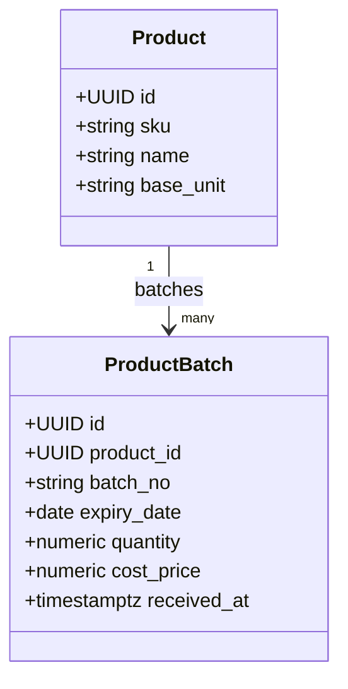
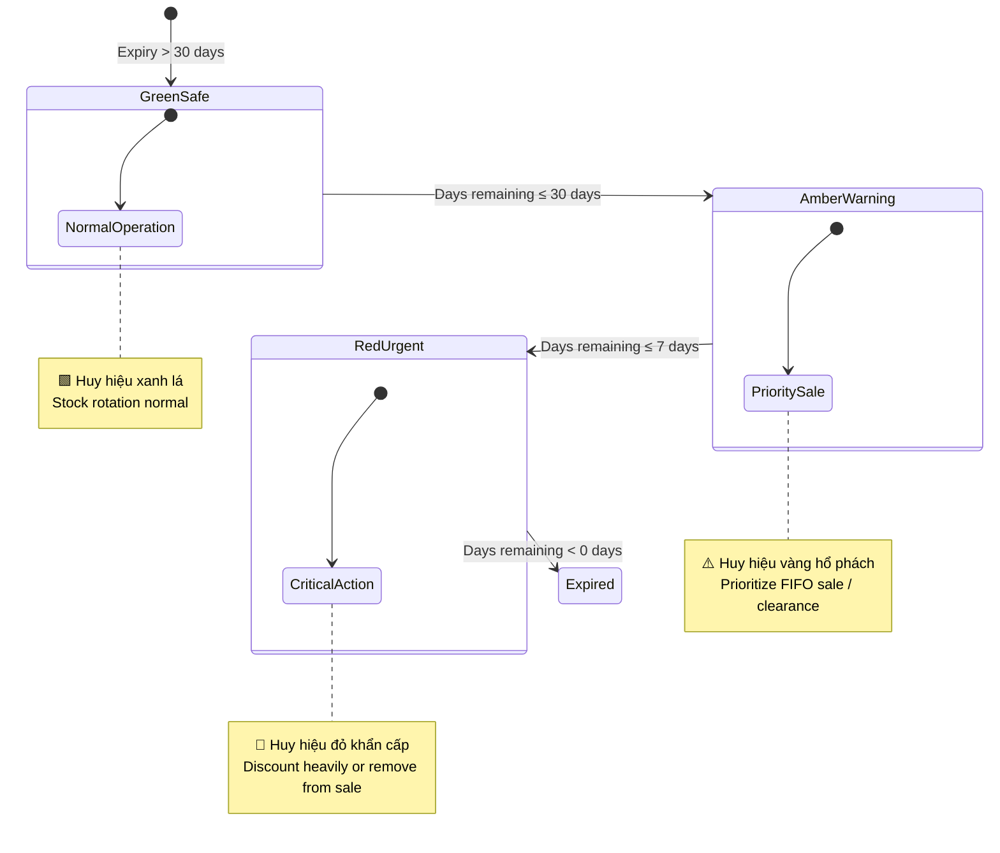

# Batch Expiry Tracking & Inventory FIFO

Managing perishable groceries (dairy, fresh meats, produce) and cosmetics requires strict monitoring of product expiration dates and inward acquisition costs. The application implements batch-level tracking with First-In, First-Out (FIFO) valuation and automatic visual expiry alerts.

---

## 1. Batch Data Model (`product_batches`)

Each inbound shipment of goods is registered as a unique batch:



- `batch_no`: Supplier invoice lot code (e.g. `L-20261001-01`).
- `expiry_date`: Absolute expiration deadline.
- `quantity`: Remaining stock balance in base units.
- `cost_price`: Inward acquisition cost per unit (used for profit and loss calculations).
- `received_at`: Inward receipt timestamp used to prioritize stock rotation (FIFO).

---

## 2. Expiry Alert Thresholds & Badges

The system categorizes inventory batches into three distinct alert tiers:



| Alert Status | Time Window | Visual Badge | Recommended Action |
| :--- | :--- | :--- | :--- |
| **An toàn** (Safe) | > 30 days | 🟩 Green Badge | Standard shelf placement |
| **Sắp hết hạn** (Warning) | 8 - 30 days | ⚠️ Amber Badge | Prioritize front-of-shelf display (FIFO) |
| **Cận date / Hết hạn** (Critical) | ≤ 7 days | 🚨 Red Badge | Immediate clearance sale or supplier return |

---

## 3. Querying Expiry Batches (`GET /api/v1/inventory/batches`)

The backend inventory handler allows filtering batches expiring within a configurable number of days:

```http
GET /api/v1/inventory/batches?expiring_within_days=30 HTTP/1.1
Host: localhost:8080
Authorization: Bearer <jwt-token>
```

### Handler Implementation (`internal/inventory/handler.go`)
```go
query := h.db.Preload("Product").Order("expiry_date ASC")

if daysStr := c.Query("expiring_within_days"); daysStr != "" {
    if days, err := strconv.Atoi(daysStr); err == nil {
        cutoffDate := time.Now().AddDate(0, 0, days)
        query = query.Where("expiry_date <= ?", cutoffDate)
    }
}

var batches []models.ProductBatch
if err := query.Find(&batches).Error; err != nil {
    c.JSON(http.StatusInternalServerError, gin.H{"error": "Failed to fetch batches"})
    return
}
```

Batches are returned in ascending order of `expiry_date`, ensuring that the most critical items appear at the very top of the table.

---

## 4. FIFO Inventory Valuation

When reporting inventory valuation:
1. Inward stock is consumed in the order of `received_at` / `expiry_date`.
2. Oldest batches are depleted first.
3. Cost of Goods Sold (COGS) reflects the actual historical cost prices stored in `product_batches.cost_price`, preventing tax distortions caused by wholesale inflation.
