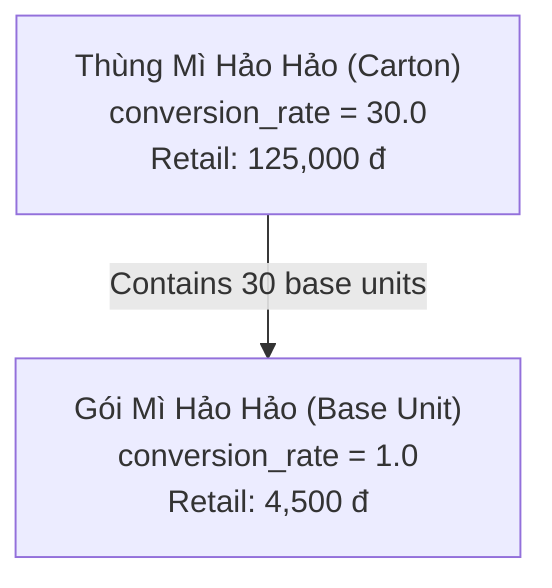
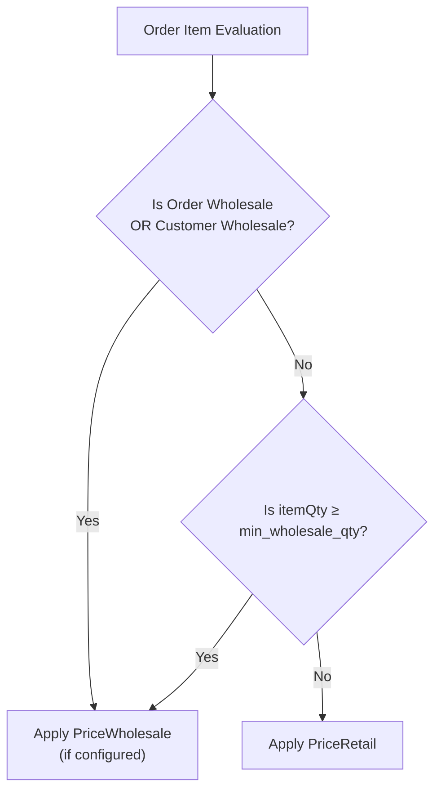

# Multi-Unit Conversions & Wholesale Tiering

Vietnamese retail shops frequently purchase and sell products across varying unit hierarchies. A grocery store might sell pens individually (`cây`), by the box (`hộp 20 cây`), or by the carton (`thùng 50 hộp`). The multi-unit conversion engine (`backend/pkg/unit`) dynamically computes unit prices, inventory stock decrements, and volume-based wholesale discounts.

---

## 1. Unit Hierarchy Concept

Every product in `products` is tied to one primary physical **`base_unit`**:
- **Piece items:** `cây`, `cuốn`, `gói`, `lon`, `chai`, `hộp`, `cái`
- **Weight items:** `kg`

In the child table `product_units`, multiple packaging variations are registered with a `conversion_rate` indicating how many base units correspond to 1 of that unit:

```text
Total Base Units = Quantity × conversion_rate
```



---

## 2. Unit Resolver Interface (`backend/pkg/unit/resolver.go`)

```go
type ResolvedUnit struct {
    UnitID          uuid.UUID
    UnitName        string
    ConversionRate  decimal.Decimal
    PriceRetail     money.VND
    PriceWholesale  *money.VND
    MinWholesaleQty *decimal.Decimal
    IsBase          bool
}

type Resolver interface {
    Resolve(ctx context.Context, productID, unitID uuid.UUID) (*ResolvedUnit, error)
    ToBase(ctx context.Context, productID, unitID uuid.UUID, qty decimal.Decimal) (decimal.Decimal, error)
}
```

---

## 3. Dynamic Price Resolution (Retail vs Wholesale Tiering)

During order creation, the system determines whether to apply standard retail pricing or discounted wholesale pricing.

### Decision Algorithm


### Code Logic in `order/handler.go`
```go
unitPrice := resolved.PriceRetail

// Check if entire order is wholesale or customer is flagged wholesale
useWholesale := (req.Type == models.OrderTypeWholesale || isCustomerWholesale)

// Alternatively check volume threshold on individual item
if !useWholesale && resolved.MinWholesaleQty != nil && itemQty.GreaterThanOrEqual(*resolved.MinWholesaleQty) {
    useWholesale = true
}

if useWholesale && resolved.PriceWholesale != nil {
    unitPrice = *resolved.PriceWholesale
}

lineTotal := unitPrice.MulByDecimal(itemQty)
```

---

## 4. Real-World Catalog Example

### Product: Mì Hảo Hảo tôm chua cay (SKU: `DAV-001`)
- **Base Unit:** `gói` (`conversion_rate = 1.0`)
- **Configured Units:**

| Unit Name | Conversion Rate | Retail Unit Price | Wholesale Unit Price | Minimum Wholesale Qty |
| :--- | :--- | :--- | :--- | :--- |
| **Gói (Base)** | `1.0000` | 4,500 đ | — | — |
| **Thùng (30 gói)**| `30.0000`| 125,000 đ | 120,000 đ | ≥ 5 thùng |

### Pricing Scenarios:
1. Customer buys **2 thùng**: Quantity is below threshold 5 → priced at retail **125,000 đ/thùng** (Total: 250,000 đ).
2. Customer buys **5 thùng**: Quantity meets volume threshold → automatically discounted to wholesale **120,000 đ/thùng** (Total: 600,000 đ).
3. Registered wholesale customer buys **1 thùng**: Order inherits wholesale status → priced at wholesale **120,000 đ/thùng**.
