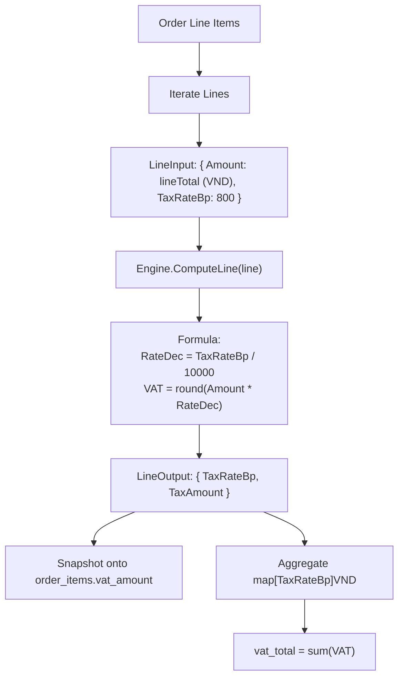

# Vietnamese Tax Calculation Engine

The application includes a tax calculation engine tailored to Vietnamese retail commerce and household business taxation laws.

---

## 1. Legal & Regulatory Background (Vietnam 2025/2026)

Vietnamese retail businesses and household merchants (*Hộ kinh doanh cá thể*) operate under specific tax regulations:

1. **Value-Added Tax (VAT / Thuế GTGT):**
   - **0% (Miễn thuế / Không chịu thuế):** Unprocessed agricultural, forestry, aquaculture, and fresh livestock products (e.g., fresh beef, pork, raw fish, fresh vegetables) per Circular 219/2013/TT-BTC.
   - **5% (Thuế suất ưu đãi):** Essential inputs and specific categories (clean piped water, medical equipment, agricultural preservation tools).
   - **8% (Thuế suất ưu đãi giảm 2%):** Under the National Assembly resolution and Decree 72/2024/NĐ-CP (extending through 2025/2026), standard 10% goods such as stationery, cosmetics, snacks, and packaged foods receive a 2% rate reduction to **8%**.
2. **Personal Income Tax (PIT / Thuế TNCN):**
   - Under Circular 40/2021/TT-BTC, retail household businesses pay a **presumptive flat PIT rate of 1.0%** calculated on gross revenue.
   - **Exemption Threshold:** If total annual revenue is below 100,000,000 VND, the business is exempt from both VAT and PIT.
   - **Warning / E-Invoice Thresholds:** 100M VND (tax obligations begin) and 1B VND (mandatory e-invoice integration via tax authority data connection).

---

## 2. Tax Engine Architecture (`backend/internal/tax`)

The tax engine is implemented as an interface `tax.Engine` with a clean computational model:



### 2.1 Basis Points Representation (`TaxRateBp`)
To eliminate floating-point representation errors, tax rates are passed internally as **basis points** (1% = 100 bp):
- 0% → 0 bp
- 5% → 500 bp
- 8% → 800 bp
- 10% → 1000 bp

### 2.2 Interface Definition (`internal/tax/tax.go`)
```go
type LineInput struct {
    TaxRateBp int64     // e.g. 800 = 8.00%
    Amount    money.VND // Pre-tax line subtotal in VND
}

type LineOutput struct {
    TaxRateBp int64
    TaxAmount money.VND
}

type Engine interface {
    Compute(lines []LineInput) (total money.VND, byRate map[int64]money.VND)
    ComputeLine(line LineInput) LineOutput
}
```

---

## 3. Mixed-Tax Invoice Calculation Walkthrough

Consider a real checkout transaction involving mixed VAT rates:

### Line Item Inputs
1. **Bút bi Thiên Long:** 2 cây × 5,000 đ = **10,000 đ** (VAT 8%)
2. **Thịt bò Úc tươi:** 0.7 kg × 250,000 đ/kg = **175,000 đ** (VAT 0%)
3. **Sữa tươi Vinamilk:** 1 hộp × 32,000 đ = **32,000 đ** (VAT 8%)

### Step-by-Step Calculation
1. **Compute Line 1 VAT (8%):**
   
```text
VAT_1 = round(10,000 × (800) / (10,000)) = 800 VND
```

2. **Compute Line 2 VAT (0%):**
   
```text
VAT_2 = round(175,000 × (0) / (10,000)) = 0 VND
```

3. **Compute Line 3 VAT (8%):**
   
```text
VAT_3 = round(32,000 × (800) / (10,000)) = 2,560 VND
```

4. **Subtotal Calculation:**
   
```text
Subtotal = 10,000 + 175,000 + 32,000 = 217,000 VND
```

5. **Grouped VAT Totals:**
   - Group `8%`: 800 + 2,560 = 3,360 VND
   - Group `0%`: 0 VND
   - **Total VAT:** 3,360 VND
6. **Net Invoice Total:**
   
```text
Net Total = Subtotal + Total VAT = 217,000 + 3,360 = 220,360 VND
```

7. **Cash Payment Rounding (nearest 100 VND):**
   
```text
Grand Total = round_100(220,360) = 220,400 VND
```

---

## 4. Immutable Invoice Line Snapshotting

When the cashier clicks **THANH TOÁN (Checkout)**, the order processing handler persists the exact tax parameters into `order_items`:
- `order_items.vat_rate`: `8.00`
- `order_items.vat_amount`: `800`

If the National Assembly subsequently restores the VAT rate to 10%, future updates to `tax_categories` will have zero effect on this existing order. The customer's re-downloaded PDF invoice and historical tax audits remain 100% stable and verifiable.

---

## 5. Retail PIT Estimation Calculation

In the tax reporting module (`GET /api/v1/reports/tax`), the 1.0% retail PIT is dynamically computed on gross sales:

```go
// 1% Presumptive Retail PIT per Circular 40/2021/TT-BTC
pitEstimate := decimal.NewFromInt(grossRevenue).
    Mul(decimal.NewFromFloat(0.01)).
    Round(0).
    IntPart()
```

This estimate gives shop owners immediate visibility into their tax liabilities ahead of monthly or quarterly filings with local tax departments.
