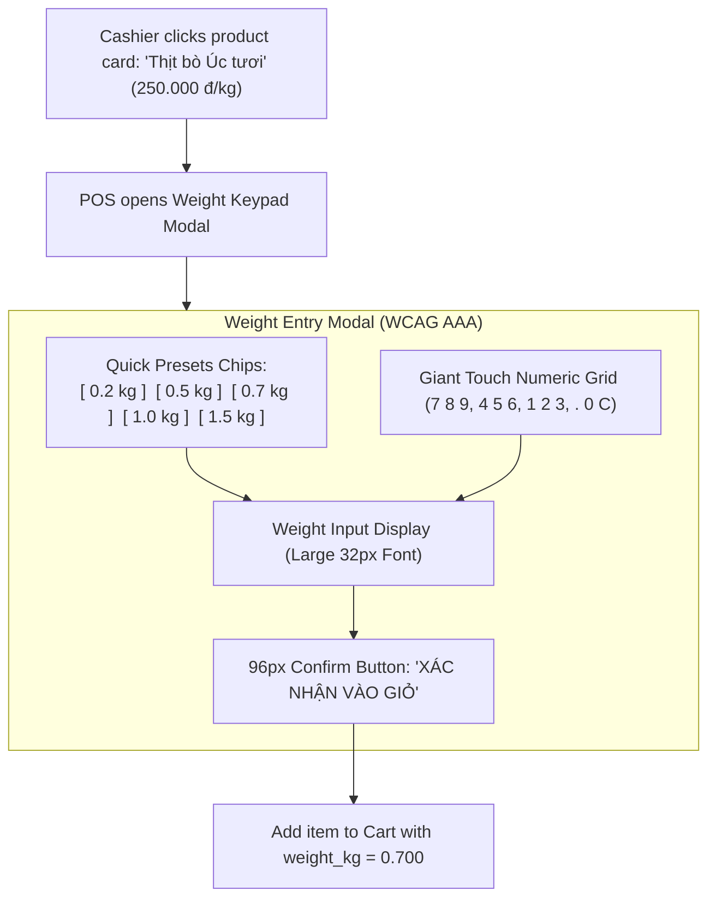

# Weight-Based Sales & Electronic Scale Workflow

In Vietnamese grocery stores and wet markets, fresh meat, seafood, and vegetables are sold by weight rather than discreet piece counts. The application provides an integrated electronic scale workflow supporting decimal quantities down to grams.

---

## 1. Weight Precision & Data Types

- **Precision:** Weights are measured in kilograms (`kg`) and formatted to **3 decimal places** (0.001 kg = 1 gram).
- **Database Column:** `order_items.weight_kg NUMERIC(10,3) NULL`.
- **Order Line Quantity:** In `order_items.quantity`, the numeric value stores the decimal weight (e.g. `0.700`).
- **Order Type:** When an order contains weighed items, its header `orders.type` is set to `weight` (or `retail` if mixed).

---

## 2. Touchscreen Numeric Keypad Modal

When a cashier clicks on any fresh product whose `base_unit` is `kg` (such as *Thịt bò Úc*, *Thịt ba chỉ*, *Cá hồi phi lê*), the POS interface intercepts the click and displays a high-contrast touch keypad modal:



### UI Features:
1. **Quick-Select Preset Chips:** One-tap buttons for common grocery purchase weights:
   - `0.2 kg` (2 lạng)
   - `0.5 kg` (nửa ký)
   - `0.7 kg` (7 lạng)
   - `1.0 kg` (1 ký)
   - `1.5 kg` (ký rưỡi)
2. **Oversized Number Buttons:** Button targets exceed 64× 64px to prevent mis-clicks with wet or gloved fingers.
3. **Real-time Price Preview:** Displays the exact calculated subtotal as digits are typed (e.g. typing `0.7` immediately previews `175.000 đ`).

---

## 3. Order Processing & Math Verification

When an order containing weighed items is submitted to `POST /api/v1/orders`:

### Payload Structure
```json
{
  "type": "weight",
  "customer_id": null,
  "items": [
    {
      "product_id": "4b971a81-d1c2-4a0b-853b-e01c801b7a01",
      "unit_id": "8c679234-f3a1-43e8-9366-b258679b3d02",
      "weight_kg": 0.7
    }
  ],
  "discount": 0
}
```

### Backend Resolution in `order/handler.go`
```go
var itemQty decimal.Decimal
if itemReq.WeightKg != nil && itemReq.WeightKg.GreaterThan(decimal.Zero) {
    itemQty = *itemReq.WeightKg
}

// Unit price: 250,000 VND / kg
unitPrice := resolved.PriceRetail

// Line total: 250,000 * 0.7 = 175,000 VND
lineTotal := unitPrice.MulByDecimal(itemQty)
```

The line item is saved with:
- `quantity`: `0.700`
- `weight_kg`: `0.700`
- `unit_price`: `250000.00`
- `line_total`: `175000.00`
- `vat_rate`: `0.00` (Fresh unprocessed meat is 0% VAT exempt)
- `vat_amount`: `0.00`
