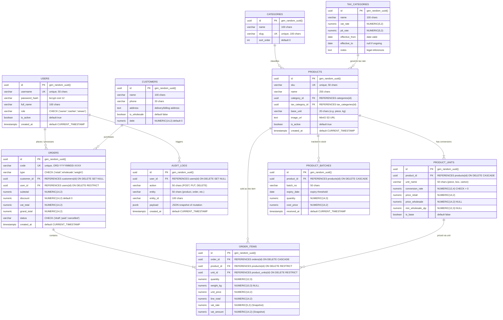

# Entity-Relationship Diagram (ERD)

This document visualizes the complete relational data model of the **Sales Management POS & Tax Application**. The database is hosted on **PostgreSQL 16** with UUID primary keys (`gen_random_uuid()`) and exact decimal representations for financial transactions.

---

## 1. Complete System ERD (Mermaid)

---

## 2. Referential Integrity & Cascade Rules

| Parent Entity | Child Entity | Foreign Key Column | On Delete Action | Business Reason |
| :--- | :--- | :--- | :--- | :--- |
| `products` | `product_units` | `product_id` | **CASCADE** | Deleting a product removes all of its associated unit configurations. |
| `products` | `product_batches` | `product_id` | **CASCADE** | Deleting a product removes its inventory batch records. |
| `categories` | `products` | `category_id` | **RESTRICT** | Prevents accidental deletion of categories that currently contain active products. |
| `tax_categories` | `products` | `tax_category_id` | **RESTRICT** | Prevents deletion of tax rules that are linked to catalog items. |
| `orders` | `order_items` | `order_id` | **CASCADE** | Deleting an order document cascades to its line item constituents. |
| `products` | `order_items` | `product_id` | **RESTRICT** | Historic order records cannot lose their product references. |
| `product_units` | `order_items` | `unit_id` | **RESTRICT** | Historic line items preserve their unit measurement references. |
| `users` | `orders` | `user_id` | **RESTRICT** | Financial orders cannot have their issuing cashier or owner removed. |
| `customers` | `orders` | `customer_id` | **SET NULL** | Deleting an ad-hoc customer keeps the financial transaction intact with an anonymous customer reference. |
| `users` | `audit_logs` | `user_id` | **SET NULL** | Preserves historical audit traces even if an operator account is purged. |
