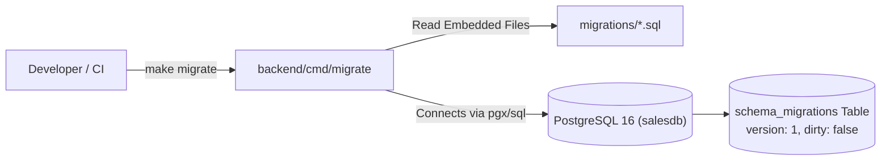

# Database Migrations

The database schema is managed via forward-only and reversible SQL migration scripts powered by `golang-migrate/migrate/v4`.

---

## 1. Migration Architecture

The migration files reside in `backend/migrations/`:
- `001_init_schema.up.sql`: Forward DDL script creating extensions, tables, foreign keys, unique indexes, and checks.
- `001_init_schema.down.sql`: Reverse DDL script dropping tables in reverse dependency order and cleaning up extensions.
- `migrations.go`: Embeds the SQL files directly into the Go binary using `//go:embed *.sql`.



---

## 2. CLI Runner (`backend/cmd/migrate/main.go`)

The migration runner is compiled into `/app/migrate` inside the `api` container. It supports standard migration verbs:

```bash
# Apply all pending migrations (Up)
docker compose exec api ./migrate up

# Roll back the most recent migration step (Down 1)
docker compose exec api ./migrate down

# Force a specific version if a dirty state occurred
docker compose exec api ./migrate force 1
```

Or directly from the host workstation via `make migrate`.

---

## 3. Migration Sequence in `001_init_schema.up.sql`

To maintain foreign key integrity, tables are created in strictly topological order:

1. `CREATE EXTENSION IF NOT EXISTS "pgcrypto";` (enables `gen_random_uuid()`)
2. `users` (independent root entity)
3. `categories` (independent catalog entity)
4. `tax_categories` (independent tax engine entity)
5. `products` (depends on `categories` and `tax_categories`)
6. `product_units` (depends on `products`, cascades on delete)
7. `product_batches` (depends on `products`, cascades on delete)
8. `customers` (independent CRM entity)
9. `orders` (depends on `users` and `customers`)
10. `order_items` (depends on `orders`, `products`, `product_units`)
11. `audit_logs` (depends on `users`)

---

## 4. Reversal Sequence in `001_init_schema.down.sql`

Down migrations cleanly drop tables in reverse dependency order:

```sql
DROP TABLE IF EXISTS audit_logs;
DROP TABLE IF EXISTS order_items;
DROP TABLE IF EXISTS orders;
DROP TABLE IF EXISTS customers;
DROP TABLE IF EXISTS product_batches;
DROP TABLE IF EXISTS product_units;
DROP TABLE IF EXISTS products;
DROP TABLE IF EXISTS tax_categories;
DROP TABLE IF EXISTS categories;
DROP TABLE IF EXISTS users;
DROP EXTENSION IF EXISTS "pgcrypto";
```

---

## 5. Adding New Migrations

When introducing a new schema alteration:
1. Create a pair of numbered SQL files: `backend/migrations/002_<name>.up.sql` and `backend/migrations/002_<name>.down.sql`.
2. Follow strict naming standards: `NNN_<descriptive_snake_case>.[up|down].sql`.
3. Test locally:
   ```bash
   make migrate
   ```
4. Update the GORM model definitions in `backend/internal/models/models.go` to match the new columns and types.
