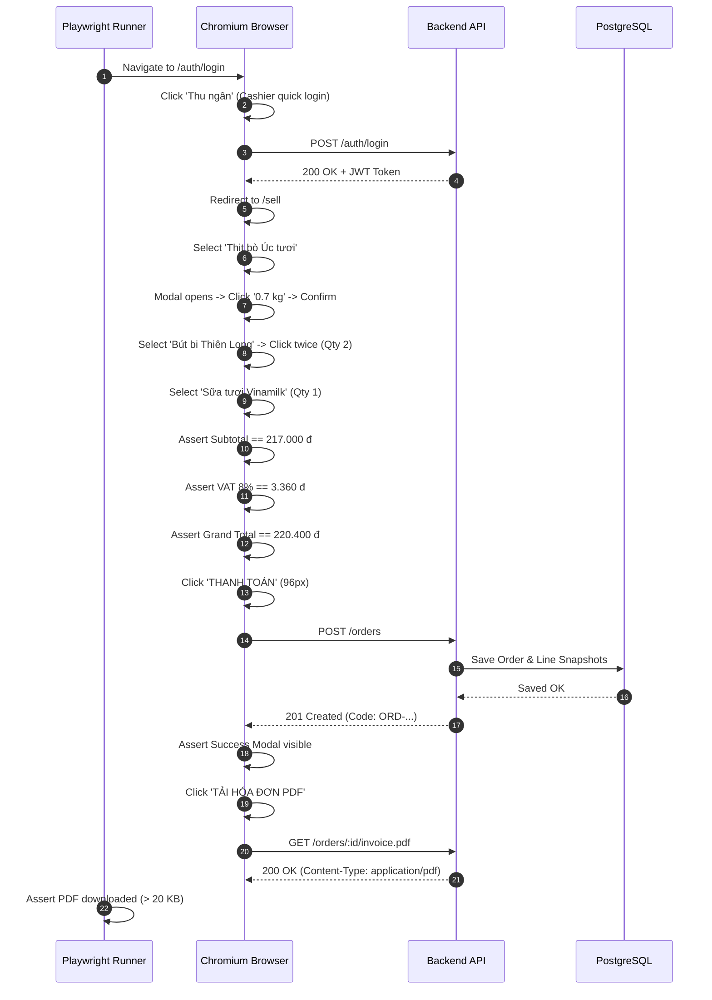

# Playwright E2E & Accessibility Tests

The frontend test suite utilizes **Playwright** paired with **`@axe-core/playwright`** to execute automated end-to-end user workflows and verify WCAG AAA compliance on real headless Chromium browser instances.

---

## 1. Test Suite Specifications

All tests reside in `frontend/e2e/`:

| Spec File | Purpose | Test Cases | Execution Time |
| :--- | :--- | :--- | :--- |
| `accessibility.spec.ts` | Automated WCAG AAA compliance | • Login Screen audit<br/>• POS Sell Screen audit<br/>• Inventory Catalog audit<br/>• Reports Dashboard audit | ~3.2s |
| `sell-flow.spec.ts` | Complete transaction lifecycle | • Login as cashier<br/>• Add items (piece & weight)<br/>• Verify mixed VAT & 100 VND rounding<br/>• Complete checkout<br/>• Download & verify PDF invoice | ~1.5s |
| `capture-screenshots.spec.ts`| Documentation visual capture | • Automated capture of all 12 application screens | ~5.0s |

---

## 2. Accessibility Auditing with Axe-Core

The accessibility spec injects `axe-core` directly into the DOM and executes audits against WCAG 2.1 Level AAA rules:

```typescript
import { test, expect } from '@playwright/test';
import AxeBuilder from '@axe-core/playwright';

test('Sell screen should meet WCAG AAA standards', async ({ page }) => {
  await page.goto('http://localhost:4200/sell');
  
  const accessibilityScanResults = await new AxeBuilder({ page })
    .withTags(['wcag2a', 'wcag2aa', 'wcag2aaa'])
    .analyze();

  expect(accessibilityScanResults.violations).toEqual([]);
});
```

### Verified Audit Criteria:
- **Zero Critical Violations:** Zero critical or serious accessibility flags detected.
- **Color Contrast:** All text elements exceed 7:1 contrast against their rendered background surfaces.
- **Tap Target Dimensions:** All interactive inputs, buttons, and card links satisfy ≥ 48× 48px.
- **Form Labels:** Every form input has an explicitly linked label with `for` or `aria-label`.

---

## 3. End-to-End POS Sell Flow (`sell-flow.spec.ts`)

The end-to-end POS workflow test automates the standard grocery checkout:



---

## 4. Running Playwright Tests

```bash
# Navigate to frontend directory
cd frontend

# Run all Playwright tests in headless mode
npx playwright test

# Run tests with interactive UI debugger
npx playwright test --ui

# Run only accessibility verification
npx playwright test e2e/accessibility.spec.ts
```
