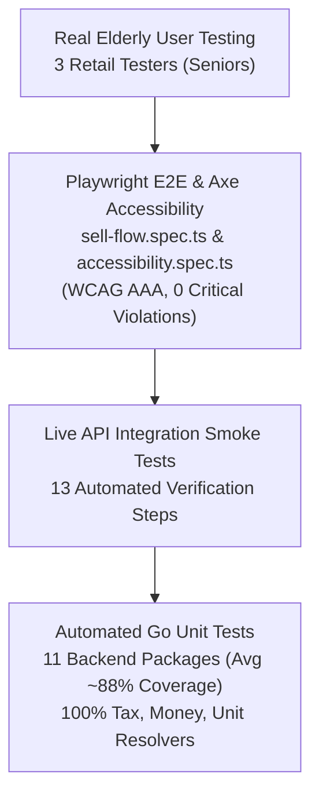

# Quality Assurance Testing Strategy

The quality assurance strategy for the **Sales Management POS & Tax Application** follows a multi-tier testing pyramid to guarantee mathematical accuracy, data integrity, user accessibility, and high availability.

---

## 1. Testing Pyramid Overview

---

## 2. Quality Gates & Acceptance Standards

Before code is approved for release or deployment, it must satisfy four mandatory quality gates:

1. **Gate 1 — Backend Unit Coverage:**
   - Core mathematical packages (`internal/tax`, `pkg/money`, `pkg/unit`) must achieve **100% statement coverage**.
   - All other packages (`auth`, `catalog`, `inventory`, `order`, `report`, `invoice`, `middleware`, `jwt`) must achieve ≥ 70% statement coverage.
2. **Gate 2 — Live Integration Smoke Test:**
   - Full 13-step transaction sequence verified against a live Docker stack via `scripts/test_smoke.sh` and `test_order.sh`.
3. **Gate 3 — Playwright E2E POS Workflow:**
   - Automated end-to-end checkout flow from login to receipt generation executed via headless browser.
4. **Gate 4 — Automated WCAG AAA Axe Audit:**
   - Zero critical or serious accessibility violations across all primary screens (Login, Sell, Inventory, Reports).

---

## 3. Test Automation Execution Commands

| Test Category | Execution Command | Execution Scope |
| :--- | :--- | :--- |
| **All Backend Unit Tests** | `make test` | Runs `go test -v -cover ./...` inside `api` container |
| **Specific Package Test** | `docker compose exec api go test -v -cover ./internal/tax` | Runs isolated package suite |
| **Frontend E2E Suite** | `npx playwright test` | Executes all Playwright browser specs |
| **Accessibility Axe Audit** | `npx playwright test accessibility.spec.ts` | Runs automated WCAG AAA axe checks |
| **Live Smoke Test Script** | `bash scripts/test_smoke.sh` | Executes live API sequence against localhost:8080 |
