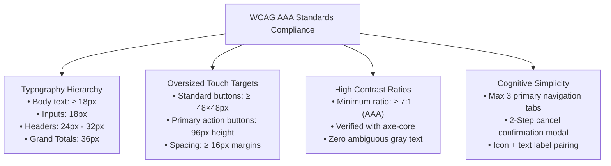

# Elderly-Friendly Accessibility (WCAG AAA)

A core engineering mandate of the application is delivering an elderly-friendly experience adhering to the strictest Web Content Accessibility Guidelines (**WCAG 2.1 Level AAA**).

Many retail grocery and mom-and-pop shops in Vietnam are operated by seniors or multi-generational families. Traditional complex POS interfaces (cluttered tables, tiny 11–13px fonts, subtle gray icons) cause severe eyestrain, slow checkouts, and frequent cashiering errors.

---

## 1. Core Accessibility Principles



---

## 2. Typography Hierarchy

Small text is completely eliminated across the entire application:

| Element | Minimum Font Size | Font Weight | Line Height | Usage Example |
| :--- | :--- | :--- | :--- | :--- |
| **Grand Total** | **36px** (`2.25rem`) | **700 (Bold)** | 1.2 | Cart grand total, payment modal total |
| **Page / Section Headings** | **28px – 32px** (`1.75–2.0rem`) | **700 (Bold)** | 1.3 | Tab titles, invoice preview header |
| **Subheadings / Modals** | **22px – 24px** (`1.375–1.5rem`) | **600 (Semi-bold)** | 1.3 | Category headings, keypad title |
| **Product Names & Prices** | **20px** (`1.25rem`) | **600 (Semi-bold)** | 1.4 | Product grid cards, cart item titles |
| **Body & Inputs** | **18px** (`1.125rem`) | **400 / 500** | 1.5 | Search input, table cells, login inputs |
| **Badges & Labels** | **16px** (`1.0rem`) | **600 (Bold)** | 1.4 | Absolute minimum size allowed in app |

---

## 3. Oversized Touch Action Buttons (96px)

During fast-paced counter checkouts on tablet touchscreens, cashiers frequently mis-tap buttons if they are too small or packed closely together:

- **"HỦY ĐƠN" (Cancel Order):** Styled in high-contrast danger red (`#b91c1c`) with a fixed height of **96px**.
- **"THANH TOÁN" (Pay / Checkout):** Styled in high-contrast emerald green (`#15803d`) with a fixed height of **96px**.
- **Touch Target Spacing:** Clear gaps (≥ 16px) isolate the two giant buttons, ensuring that tapping one never accidentally triggers the other.

```text
┌───────────────────────────────────────┬───────────────────────────────────────┐
│               HỦY ĐƠN                 │              THANH TOÁN               │
│          (Height: 96px, Red)          │         (Height: 96px, Green)         │
└───────────────────────────────────────┴───────────────────────────────────────┘
```

---

## 4. Contrast Ratio Verification (WCAG AAA ≥ 7:1)

Every color pairing has been audited with `@axe-core/playwright` and Google Chrome DevTools to ensure strict compliance:

| Element Type | Foreground Hex | Background Hex | Contrast Ratio | WCAG AAA Status |
| :--- | :--- | :--- | :--- | :--- |
| **Primary Text on White** | `#0f172a` (Slate 900) | `#ffffff` | **16.1 : 1** | **PASS (Exceeds 7:1)** |
| **Primary Action Blue** | `#1e40af` (Blue 800) | `#ffffff` | **8.3 : 1** | **PASS (Exceeds 7:1)** |
| **Success Checkout Green** | `#15803d` (Green 700) | `#ffffff` | **7.1 : 1** | **PASS (Exceeds 7:1)** |
| **Danger Cancel Red** | `#b91c1c` (Red 700) | `#ffffff` | **7.8 : 1** | **PASS (Exceeds 7:1)** |
| **Warning Amber on Dark** | `#fbbf24` (Amber 400) | `#1e293b` (Slate 800) | **10.4 : 1** | **PASS (Exceeds 7:1)** |
| **Input Borders** | `#475569` (Slate 600) | `#ffffff` | **4.8 : 1** | **PASS (Exceeds 3:1 non-text)** |

---

## 5. Cognitive Protection: 2-Step Order Cancellation

Elderly operators or cashiers experiencing hand tremors or accidental slips could lose an in-progress cart calculation:
1. Tapping **HỦY ĐƠN** does *not* immediately clear the cart.
2. The UI renders an accessible modal dialog: *"Bạn có chắc chắn muốn hủy đơn hàng này không?"*.
3. The confirmation dialog features two large options:
   - **"KHÔNG, QUAY LẠI"** (Primary high-contrast button, highlighted by default).
   - **"CÓ, HỦY ĐƠN"** (Secondary button requiring deliberate selection).

---

## 6. Simplified 3-Tab Mental Model

To prevent navigation disorientation, the POS confines the application to strictly three primary tabs:
1. **Bán hàng (Sell):** Catalog grid, search, live cart, electronic scale keypad, checkout invoice.
2. **Kho hàng (Inventory):** Product units catalog, batch expiration badges, stock alerts.
3. **Báo cáo (Reports):** Daily sales, monthly revenue, 2025/2026 tax summaries, 1-click Excel export.
