# UI Walkthrough & Application Screens

This document provides a visual guide and workflow analysis for all 12 screens and modals of the **Sales Management POS & Tax Application**. All images are stored in `wiki/assets/screenshots/` in the `grocery-store` repository.

---

## 1. Màn Hình Đăng Nhập (Login Screen)

- **Purpose:** Secure operator authentication with high-contrast accessibility and 1-tap quick login for seeded demo personas (`Chủ tiệm`, `Thu ngân`, `Xem báo cáo`).
- **Accessibility:** Large input fields (18px text), prominent action buttons, and ≥ 7:1 contrast.

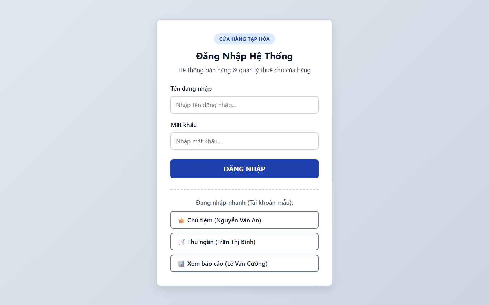

---

## 2. Màn Hình Bán Hàng Ban Đầu (Sell Screen - Empty Cart)

- **Layout Structure:**
  - **Left Section:** Product search bar, scrollable category navigation bar, and responsive grid of 150× 150px touch product cards.
  - **Right Section:** Live shopping cart, subtotal, VAT breakdown, grand total, and giant **96px** transaction buttons ("HỦY ĐƠN" & "THANH TOÁN").

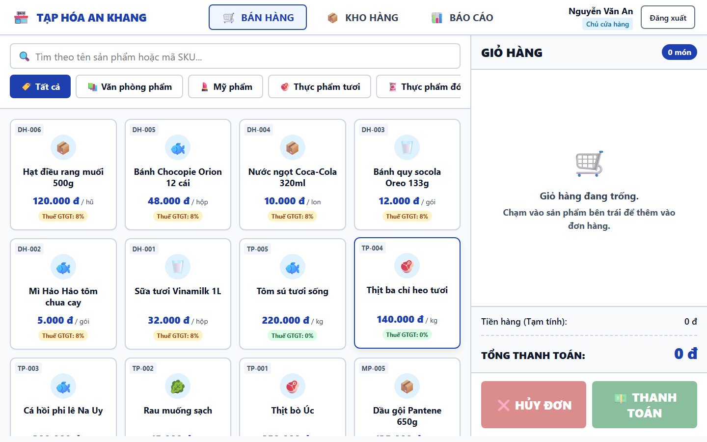

---

## 3. Lọc Hàng Hóa Theo Danh Mục (Category Filtering)

- **Action:** Clicking on the **Thực phẩm tươi (Fresh Food)** category filter displays tax-exempt (VAT 0%) agricultural and livestock items: *Tôm sú tươi sống*, *Thịt ba chỉ*, *Cá hồi phi lê Na Uy*, *Rau muống sạch*, *Thịt bò Úc*.

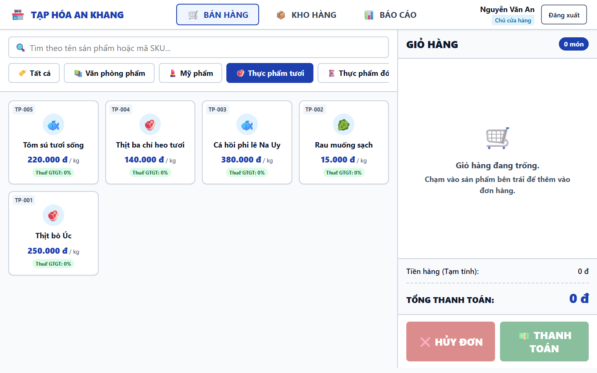

---

## 4. Bàn Phím Số Cân Ký Cảm Ứng (Touch Weight Keypad Modal)

- **Trigger:** Tapping any product sold by weight (such as *Thịt bò Úc* at 250.000 đ/kg) opens this dedicated electronic scale modal.
- **Controls:** Quick preset chips (`0.2 kg`, `0.5 kg`, `0.7 kg`, `1.0 kg`, `1.5 kg`), full touch numeric keypad, and live price preview.

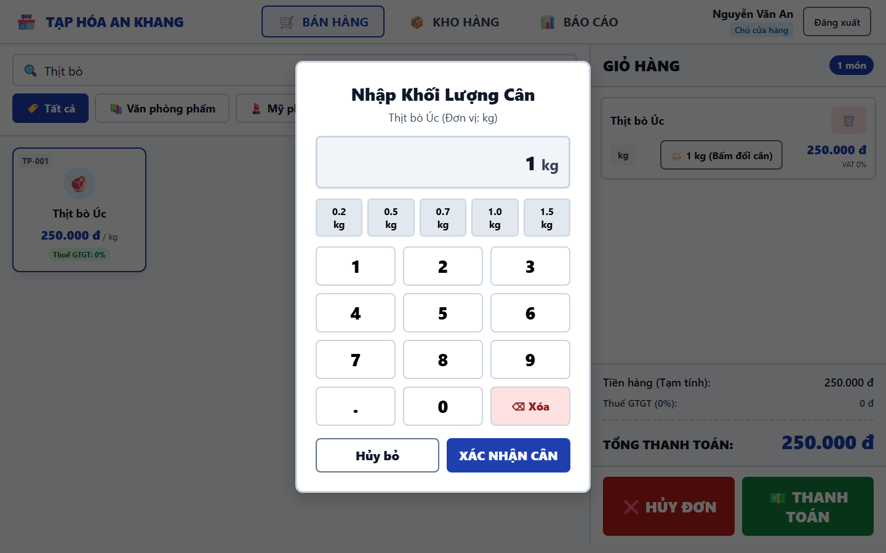

---

## 5. Giỏ Hàng Tính Thuế Hỗn Hợp (Mixed-VAT Cart)

- **Scenario:** A customer purchases:
  - 🥩 **0.7 kg Thịt bò Úc** @ 250,000 đ = 175,000 đ (VAT 0% = 0 đ)
  - 🖊️ **2 cây Bút bi Thiên Long** @ 5,000 đ = 10,000 đ (VAT 8% = 800 đ)
  - 🥛 **1 hộp Sữa tươi Vinamilk** @ 32,000 đ = 32,000 đ (VAT 8% = 2,560 đ)
- **Financial Calculation:**
  - **Tiền hàng (Subtotal):** 217.000 đ
  - **Thuế GTGT 8%:** 3.360 đ
  - **Thuế GTGT 0%:** 0 đ
  - **Tổng tiền chính xác:** 220.360 đ
  - **Làm tròn tiền mặt (bội số 100 đ):** **220.400 đ** displayed in bold **36px** font.

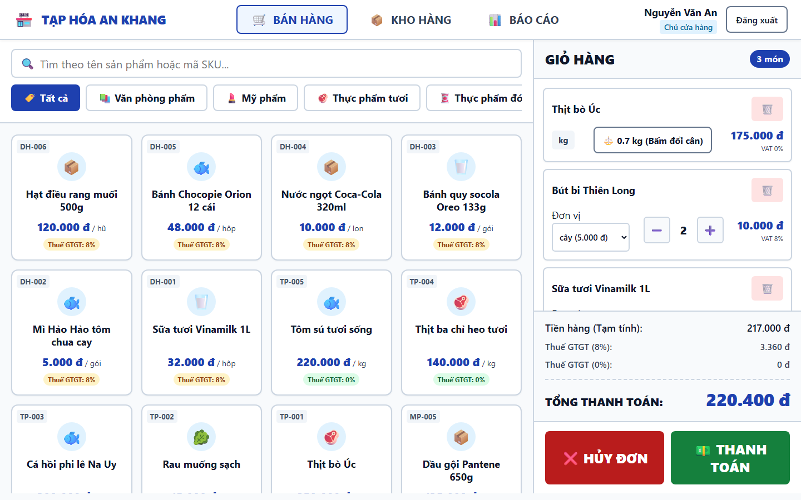

---

## 6. Hộp Thoại Xác Nhận Hủy Đơn (2-Step Cancel Confirmation)

- **Safety Feature:** Clicking the red **HỦY ĐƠN (96px)** button triggers this modal to safeguard against accidental touches, requiring an explicit confirmation before clearing the cart.

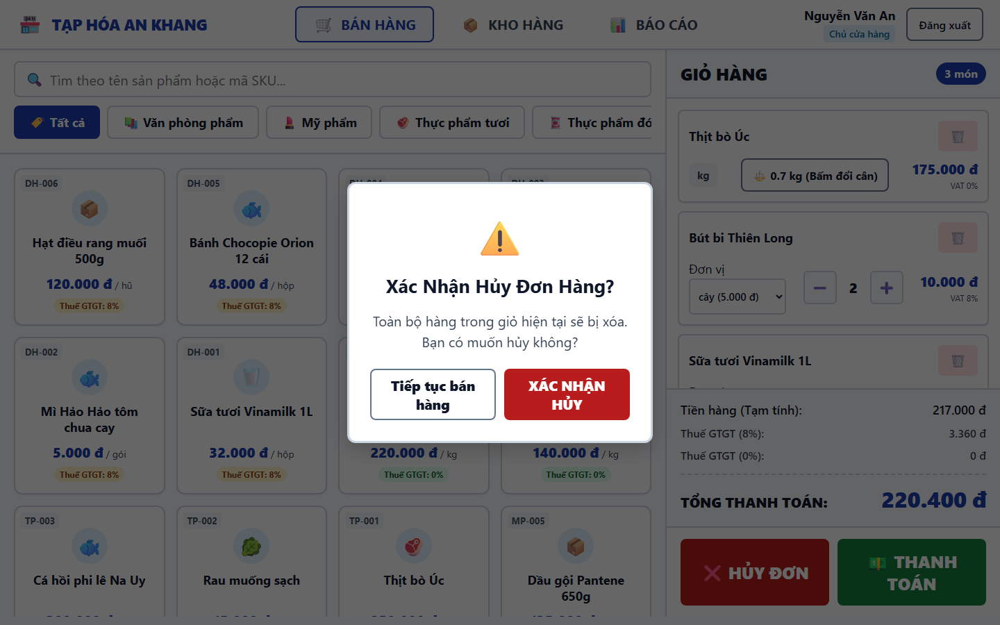

---

## 7. Thanh Toán Thành Công & Xem Trước Hóa Đơn (Payment Success)

- **Completion:** Tapping **THANH TOÁN (96px)** saves the order to PostgreSQL, snapshots VAT rates, generates code `ORD-YYYYMMDD-XXXX`, and provides a direct download link for the native UTF-8 Vietnamese PDF invoice.

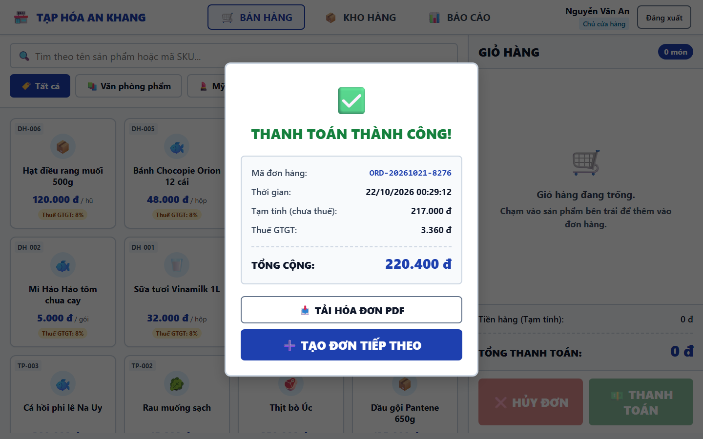

---

## 8. Quản Lý Kho & Đơn Vị Quy Đổi (Inventory Catalog)

- **Features:** Comprehensive product inventory table displaying SKU, Product Name, Base Unit, VAT Category, Retail Unit Price, and Multi-unit Wholesale conversion rules.

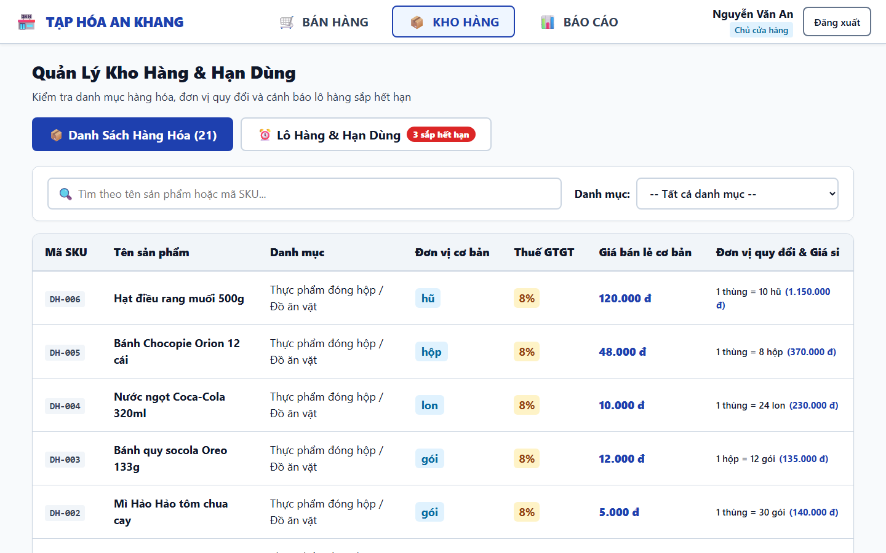

---

## 9. Cảnh Báo Lô Hàng Hết Hạn (Batch Expiry Alerts)

- **Visual Badges:**
  - 🚨 **Đỏ (Cận date ≤ 7 ngày):** Critical alert for rapid clearance.
  - ⚠️ **Vàng (Sắp hết hạn ≤ 30 ngày):** Priority FIFO stock rotation.
  - 🟩 **Xanh lá (An toàn > 30 ngày):** Standard stock status.

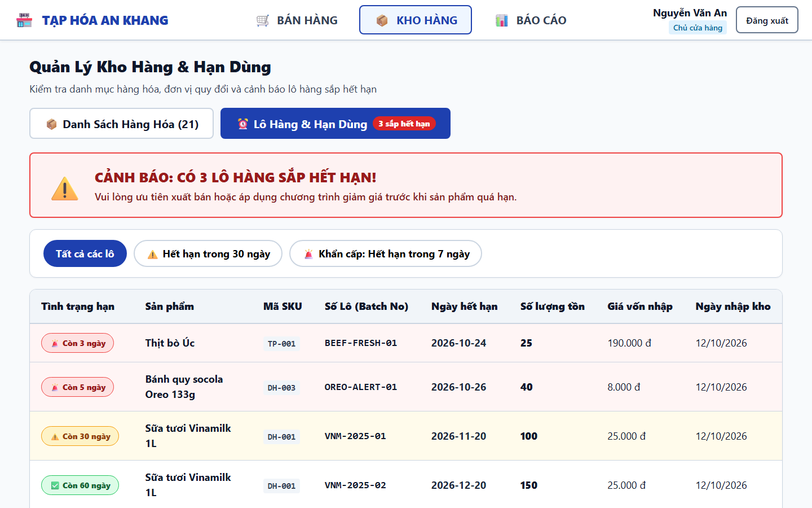

---

## 10. Báo Cáo Doanh Thu Theo Ngày (Daily Dashboard)

- **Analytics:** Tracks daily revenue, total VAT collected for the government, total completed order transactions, and category sales share.

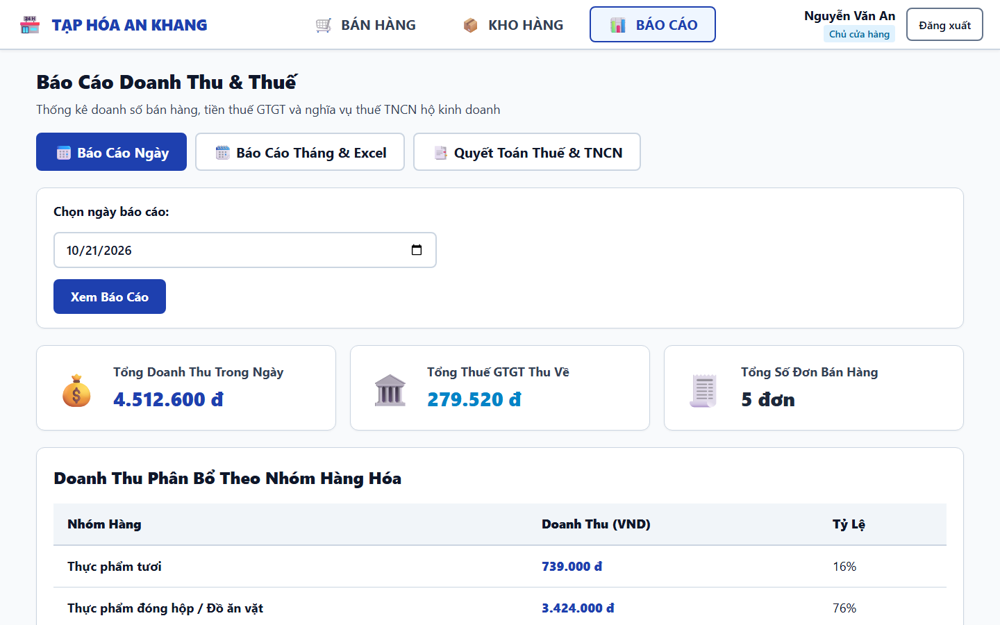

---

## 11. Báo Cáo Doanh Thu Tháng & Xuất Excel (Monthly Reports)

- **Features:** Monthly revenue totals, daily transaction breakdown, and a 1-click **XUẤT FILE EXCEL (.XLSX)** button for bookkeeping.

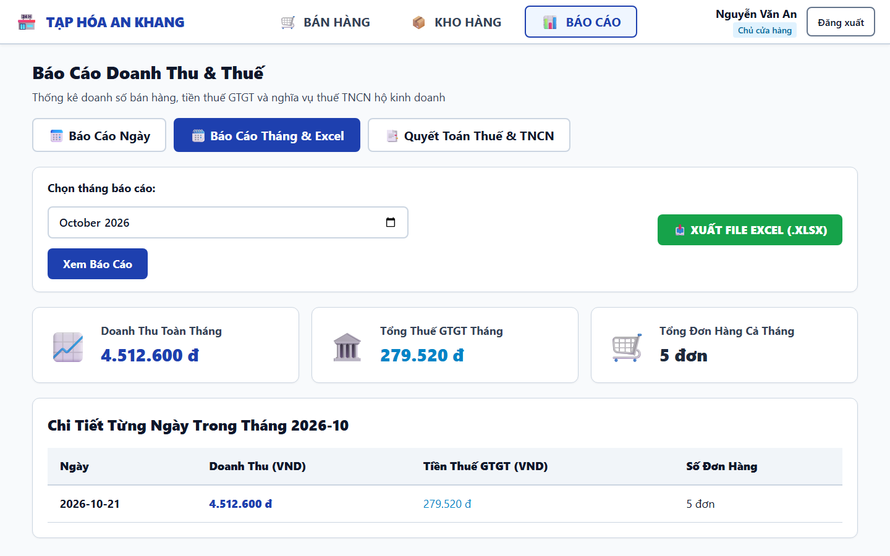

---

## 12. Quyết Toán Thuế GTGT & Thuế TNCN 1% (Tax Settlement)

- **Compliance Dashboard:**
  - Gross sales breakdown by VAT rate (0%, 5%, 8%).
  - Total VAT remittance liability.
  - Estimated **1.0% Presumptive Retail Personal Income Tax (PIT / Thuế TNCN)** under Circular 40/2021/TT-BTC.

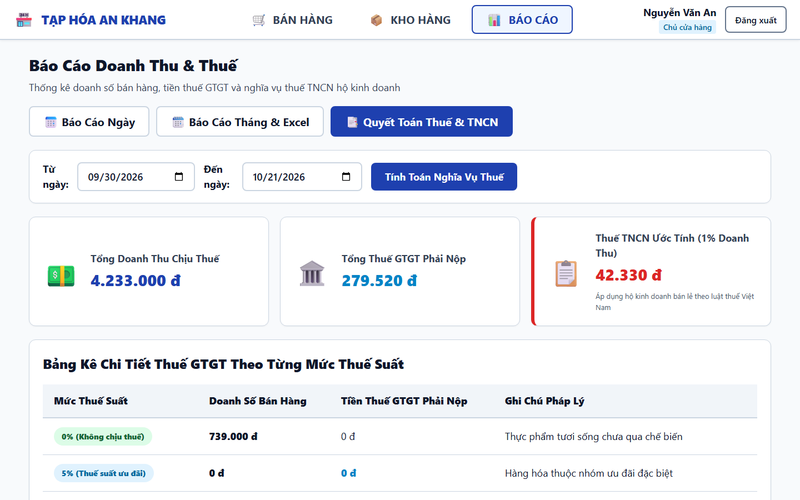
