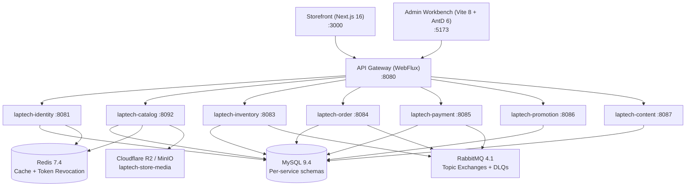
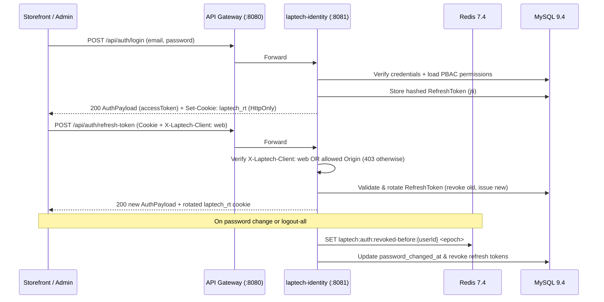

# Platform Architecture

Laptech is a **multi-service e-commerce platform** organized as a 9-module Maven repository (`laptech-api`) serving two independent web applications (`laptech-client-web-ui` and `laptech-admin-web-ui`). Every browser request enters through the **API Gateway (`:8080`)**.

## System Topology

## DDD 4-Layer Architecture (Enforced by ArchUnit)

Each of the 7 domain services (`identity`, `catalog`, `inventory`, `order`, `payment`, `promotion`, `content`) enforces strict hexagonal/DDD boundaries via ArchUnit tests:

1. **`domain/`** — Pure Java aggregates, entities, value objects, domain events, and repository interfaces. No Spring or JPA dependencies.
2. **`application/`** — Use cases, application services, DTOs, MapStruct mappers, and event handlers.
3. **`infrastructure/`** — Spring Data JPA implementations, OpenFeign clients, RabbitMQ producers/consumers, Redis cache/revocation, R2/S3 storage adapters.
4. **`interfaces/`** — REST controllers, validation, and HTTP delivery.

Shared cross-cutting code lives in **`laptech-common`**: `ResponseEnvelope<T>`, global exception handling, JWT parsing + Redis revocation filter, `RequiredSecretsEnvironmentPostProcessor`, and RabbitMQ exchange/queue constants.

## API Gateway Route Precedence

`laptech-gateway` (`:8080`) owns CORS (`APP_CORS_ALLOWED_ORIGINS`) and aggregates OpenAPI docs at `/swagger-ui.html`. Because `laptech-identity` owns catch-all routes (`/api/admin/**` and `/api/me/**`), more specific admin and self-service routes **must stay above** them in gateway config:

- `/api/admin/products/**`, `/api/admin/categories/**`, `/api/admin/brands/**`, `/api/admin/tags/**`, `/api/admin/attributes/**`, `/api/admin/media/**` → `laptech-catalog`
- `/api/admin/orders/**` → `laptech-order`
- `/api/admin/payment-providers/**` → `laptech-payment`
- `/api/me/comments/**` → `laptech-content`
- `/api/admin/**`, `/api/me/**`, `/api/auth/**` → `laptech-identity`

## Authentication, CSRF Guard & Distributed Revocation

### Login & Token Refresh Flow

Key security invariants:

- **Dual-token model:** Short-lived JWT access token kept in memory on clients + long-lived HttpOnly `laptech_rt` refresh cookie (rotated on every refresh).
- **CSRF guard on cookie endpoints:** `POST /api/auth/refresh-token` and `POST /api/auth/logout` require either `X-Laptech-Client: web` or an allowed `Origin` in `APP_CORS_ALLOWED_ORIGINS`; otherwise the server returns `403 Forbidden`.
- **Distributed revocation:** All services check Redis key `laptech:auth:revoked-before:{userId}` via `laptech-common` (failing open with a throttled warning if Redis is unreachable), while `laptech-identity` also verifies DB `password_changed_at`, `is_active`, and `deleted_at`.
- **Seeded PBAC:** `PermissionRoleSeeder` auto-seeds 5 roles (`ADMIN`, `MANAGER`, `EMPLOYEE`, `SELLER`, `USER`), 69 permissions, 201 grants, and a role hierarchy DAG on boot. Seeded roles and permissions are protected from deletion and renaming.
- **Fail-fast secrets:** Outside `dev`/`test`, `RequiredSecretsEnvironmentPostProcessor` refuses startup if `DB_PASSWORD`, `RABBITMQ_PASSWORD`, or `APP_JWT_SECRET` (≥ 32 raw UTF-8 bytes) is missing; `prod` also requires `DB_URL`, `DB_USERNAME`, `RABBITMQ_HOST/PORT/USERNAME`, and `REDIS_PASSWORD`.

## Synchronous & Asynchronous Communication

- **Synchronous (OpenFeign):** Inter-service queries on `/api/internal/**` (for example, `laptech-order` verifying current catalog prices at checkout per [ADR-0002](../adr/0002-order-snapshot-and-checkout-price.md)).
- **Asynchronous (RabbitMQ 4.1):** Topic exchanges `laptech.order`, `laptech.payment`, `laptech.inventory`, and dead-letter exchange `laptech.dlx` with 5 work queues and 5 `.dlq` queues imported from `dev-config/rabbitmq/definitions.json`.
