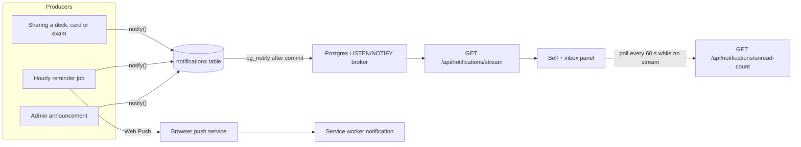

# 🔔 Notifications, Live Updates & Study Reminders

Since v2.1.0 every signed-in user has a **notification inbox**. New items arrive live over a server-sent-events (SSE) stream, can also reach a phone or desktop as a **Web Push**, and the app sends a **daily study reminder** when cards are due.

Related: [API Documentation §11](../architecture/api-documentation.md), [Database §3.11](../architecture/database-design.md), [Deployment Guide](../operations/deployment-guide.md) (cron service, VAPID keys, SSE requirements).

---

## 1. How the pieces fit



The **row in `notifications` is the source of truth.** The stream, the push and the polling fallback are only ways of telling the client that a row exists, so losing any one of them never loses a notification.

---

## 2. Notification types

Each type has a strict payload schema (`extra="forbid"`, camelCase on the wire). There is no public "create notification" route; rows are written by the backend only.

| `type` | Written when | Payload |
| --- | --- | --- |
| `srs.due` | The reminder job finds cards due for a user whose local clock is at their reminder hour | `count` (cards due) |
| `content.shared` | Someone shares an item with you | `itemType`, `itemId`, `title`, `sharedBy` |
| `system.announcement` | An admin posts an announcement | `title`, `body` (plain text) |

Guests have an inbox too, but are never subscribed to push and never receive announcements or reminders.

**Admin announcements.** `POST /api/admin/announcements` (title up to 120 characters, body up to 4,000, both non-blank) inserts one row for every **active, registered** user in a single multi-row insert. Guests and deactivated accounts are skipped.

---

## 3. Live delivery over SSE

`GET /api/notifications/stream` is one long-lived response per open tab.

| Behaviour | Value |
| --- | --- |
| Authentication | `Authorization: Bearer …` header only. Never a query-string token, which is why the old `events` router was removed |
| Content type | `text/event-stream`, with `Cache-Control: no-cache`, `X-Accel-Buffering: no` and `Content-Encoding: identity` so nothing buffers or compresses it |
| First bytes | `retry: 5000` immediately, so a proxy that buffers is noticed straight away |
| Heartbeat | A `: ping` comment every 20 s |
| Lifetime | Closed by the server after 30 minutes; the client reopens it |
| Resume | Standard `Last-Event-ID`; the server replays up to 50 missed rows |
| Cap | At most 5 open streams per user per process. The 6th gets **429** with `Retry-After: 30` |
| Queue | Each stream buffers up to 100 events. If a slow consumer overflows it, the server closes that stream and the client reconnects and replays from the database, so nothing is lost |
| Ordering | The stream subscribes to the broker *before* it replays, so a row created in between is never missed; a row heard live that the replay already sent is dropped |

### Fan-out across processes

A notification created in *any* process (an API replica, or the reminder cron job) must reach streams open in *every* API process. In production the API runs a `PostgresBroker`: one dedicated `asyncpg` connection per process executes `LISTEN notifications`, and publishers call `pg_notify` **after** committing. The listener reconnects with a 1 s → 30 s back-off. Without Postgres (local SQLite) an in-process broker is used instead.

Two consequences for operators:

- The `LISTEN` connection is **not** taken from the pool, so budget one extra database connection per API process.
- It needs a **direct** Postgres connection. A transaction-pooling proxy (PgBouncer in transaction mode) cannot carry `LISTEN`.

The stream does not hold a database session while it waits (a held session per open tab would exhaust the pool). It authenticates once, then every later lookup opens its own short session. See *Transaction ownership* in `backend/CLAUDE.md`.

### The client

`features/notifications/` owns the connection through the notification store:

- Connects through `apiStream` (same `Authorization` header and 401 handling as `apiFetch`, and it rejects an answer that is not `text/event-stream`, such as an SPA fallback page).
- Reconnects with jittered back-off from 1 s up to 30 s, and resumes with `Last-Event-ID`.
- A **50 s silence watchdog** drops a dead connection (the server pings every 20 s).
- The app only counts as **live after the first bytes arrive**. Until then it polls the unread count every minute, so a proxy that buffers or caps the stream degrades to the old behaviour instead of leaving a stale bell.
- `VITE_STREAM_BASE_URL` is an optional build-time variable. When it is set, only the stream uses that origin. When it is empty, the stream follows the same origin rules as every other API call: the same-domain API on a phivo.dev page, the same-origin `/api` or `/api-staging` proxy on a `*.vercel.app` page, `VITE_API_BASE_URL` elsewhere. A proxy that buffers the stream still degrades to the minute poll until the first bytes arrive.

---

## 4. Web Push

Push needs a VAPID key pair. **Each environment must have its own** (subscriptions are bound to the key, so staging and production must differ).

| Variable | Purpose |
| --- | --- |
| `VAPID_PUBLIC_KEY` | Served to the browser |
| `VAPID_PRIVATE_KEY` | Signs pushes. Never sent to the frontend, never logged |
| `VAPID_SUBJECT` | `mailto:` contact for the push service |

If any is empty, push is simply off: `GET /api/push/vapid-public-key` returns **404**, the reminder control stays hidden, and the app still boots.

| Endpoint | Notes |
| --- | --- |
| `GET /api/push/vapid-public-key` | Public. 404 when push is not configured |
| `POST /api/push/subscriptions` | Registered (non-guest) users only. Upserts on the unique `endpoint`, so a browser that switches accounts re-owns the row rather than adding a second |
| `DELETE /api/push/subscriptions` | Body `{ endpoint }`. **404** when the endpoint is missing *or belongs to someone else* (403 would confirm it exists) |

**Endpoints are restricted to real push services.** `POST /api/push/subscriptions` returns **422** unless the URL is `https` on the default port, has no userinfo, and the host is exactly one of `fcm.googleapis.com`, `updates.push.services.mozilla.com`, `notify.windows.com`, or `web.push.apple.com`, or a subdomain of one of those (`backend/app/core/push_endpoint.py`). The reminder job checks the host again and refuses a name that resolves to a non-public address before it sends, including rows stored before the check existed.

**Dead subscriptions clean themselves up.** A push service answering 404 or 410 means the subscription is gone and the row is deleted at once. Other failures increment `failure_count`; five consecutive failures delete it. A success resets the counter and stamps `last_success_at`.

Clicking a push focuses an open tab on the right page, or opens a new window when no tab can navigate.

---

## 5. Daily study reminders

The reminder is produced by the one-shot job `python -m app.jobs.send_due_reminders`, run **every hour** by a host cron on the VPS (`7 * * * *`, UTC).

For every registered, active user who has reminders on **and** at least one push subscription, the job asks whether *that user's own local clock* is at *their* reminder hour. If it is, and they have cards due, it writes an `srs.due` inbox row and pushes to each of their devices.

| User setting | Meaning | Default |
| --- | --- | --- |
| `notificationsEnabled` | Reminders on or off | `false` |
| `reminderHour` | Local hour, integer 0–23 | `19` |
| `timeZone` | IANA zone name, validated on write | `UTC` |

Three properties keep the job safe to run at any time:

1. **Idempotent per local day.** The inbox row's `dedupe_key` is `srs.due:<user's local date>`, and a push is sent only when that insert actually happened. Running the job twice in an hour, two overlapping runs, or the 25-hour autumn day in which one local hour occurs twice all produce exactly one reminder.
2. **Commit, then send.** Rows are committed before any push goes out, so a crash can lose a push but can never send the same reminder twice.
3. **No transaction across the vendor calls.** The connection is released before pushing; a held transaction would be killed by the 15 s idle-in-transaction timeout while a slow push service answers.

An hour that is skipped is **not** caught up: the users whose hour it was miss that day's reminder. That is why the schedule must be hourly.

Work is processed in batches of 200 users with up to 10 concurrent pushes. A healthy run logs one summary line and exits 0:

```text
due reminders: considered=… due_now=… notified=… pushes_sent=… pushes_failed=… subscriptions_removed=… failed_batches=…
```

If the VAPID variables are missing the job logs that push is not configured and still exits 0. The job runs the command directly, not `entrypoint.sh`, so it does **not** run migrations (the API container owns them). See the [Deployment Guide](../operations/deployment-guide.md#scheduled-jobs-host-cron-on-the-vps).

---

## 6. Where to look in the code

| Concern | Backend | Frontend |
| --- | --- | --- |
| Inbox rows and queries | `services/notification_service.py`, `routers/notifications.py` | `features/notifications/store/`, `api.ts` |
| Stream and broker | `services/notification_stream.py`, `core/notify_broker.py` | `features/notifications/sse.ts` |
| Push subscriptions and sending | `services/push_service.py`, `routers/push.py` | service worker `sw.js` |
| Reminder job | `services/reminder_service.py`, `jobs/send_due_reminders.py` | Settings → reminders |
| Wording and click targets | – | `features/notifications/lines.ts`, `destination.ts` |
