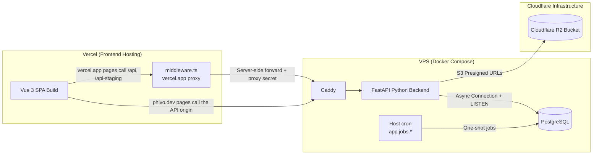

# 🚢 Deployment & DevOps Guide

How LinguFlow is deployed:

- **Frontend**: Vue 3 + Vite static SPA on **Vercel** (`frontend/dist`)
- **Backend & Database**: Python FastAPI and PostgreSQL in Docker Compose on a **VPS**, behind **Caddy**
- **Media Storage**: **Cloudflare R2**, accessed through `aioboto3` presigned S3 URLs
- **Local Dev**: Docker Compose

The API image is built and deployed by GitHub Actions: see **[VPS deploy](./vps-deploy.md)**. Railway hosted the API and Postgres until the VPS cutover; its services are gone (both `*.up.railway.app` origins answer `Application not found`). For the `staging` branch and the host names of each environment, see **[Domains and staging](./domain-cutover.md)**. The full API variable list lives in `backend/.env.example`; the Vercel build variables are in `frontend/.env.example`.

| Environment | Web hosts (Vercel) | API origin (VPS) |
| :--- | :--- | :--- |
| Production (`main`) | `https://lingu.phivo.dev`, `https://lingu-flow.vercel.app` | `https://lingu-api.phivo.dev` |
| Staging (`staging`) | `https://lingu-staging.phivo.dev`, Vercel Preview URLs | `https://lingu-api-staging.phivo.dev` (answers only with `X-Staging-Key`) |

---

## Architecture Overview



---

## 1. Local Development (`Docker Compose`)

Run the full stack locally with PostgreSQL:

```bash
# Start PostgreSQL database container
docker-compose up -d postgres

# Run backend locally
cd backend
python -m venv venv
.\venv\Scripts\activate
pip install -r requirements.txt
alembic upgrade head
uvicorn app.main:app --reload --port 8000

# Run frontend locally
cd ../frontend
npm install
npm run dev
```

`docker compose up --build` runs the whole stack. It waits for Postgres through a `healthcheck` plus `depends_on: condition: service_healthy`, so a cold start does not race-fail the migration.

---

## 2. Cloudflare R2 Bucket Setup

1. Log in to [Cloudflare Dashboard](https://dash.cloudflare.com) > **R2**.
2. Create a bucket named `linguflow-media` (and a separate `linguflow-media-staging` if you isolate staging objects).
3. Go to **R2 > Manage API Tokens** and click **Create API Token**:
   - Set permission to **Object Read & Write**.
   - Scope to `linguflow-media` bucket.
4. Record the following credentials:
   - **Access Key ID**
   - **Secret Access Key**
   - **Endpoint URL** (`https://<ACCOUNT_ID>.r2.cloudflarestorage.com`)
5. Under the bucket **Settings → CORS policy**, allow the SPA origins (`http://localhost:5173`, the phivo.dev and Vercel hosts) for `GET` / `PUT` / `HEAD` with `AllowedHeaders: ["content-type"]`. FastAPI `CORS_ORIGINS` does **not** cover the browser’s direct PUT to R2. Without this policy the card editor fails with “Không thể tải ảnh lên” and Chrome reports `CORS not configured for this bucket`. Full pipeline and diagnosis: [Card Image Uploads (R2 + CORS)](../features/card-image-uploads.md).

---

## 3. API, Postgres and jobs on the VPS

The VPS runs one Docker Compose stack per environment behind Caddy: the API (`lf-api` for production, `lf-api-stg` for staging) and its PostgreSQL. The compose file, the Caddy configuration and the API's environment file live on the server, not in this repository. A push to `main` or `staging` that touches `backend/**` builds `ghcr.io/newtc22222/lingu-flow-api:<sha>` and deploys it over SSH; see [VPS deploy](./vps-deploy.md) for the workflow, its environments and the deploy keys.

- **Migrations run on start.** The image's `backend/entrypoint.sh` runs `alembic upgrade head` before uvicorn (FastAPI's lifespan does not migrate). Do not override the container command, or migrations are skipped.
- **Caddy is the only way in.** Caddy terminates TLS and replaces `X-Forwarded-For` with the client address, so the API runs with `TRUSTED_PROXY_COUNT=1`. Do not publish the API port past Caddy: a client that reaches the app directly could set that header itself.
- **Staging is gated.** Caddy answers `lingu-api-staging.phivo.dev` only when the request carries the right `X-Staging-Key`. Staging builds send it from `VITE_STAGING_ACCESS_KEY`. The key ships in the staging bundle, which sits behind Vercel login, so it keeps out casual traffic rather than a determined visitor.
- **`ROOT_ADMIN_EMAILS`** is a comma-separated, case-insensitive allowlist of admin emails. Left empty (or unset), **no admins exist**: `/api/admin/*` answers 403 to any authenticated caller (401 first if unauthenticated). Set it before relying on the admin console.

### Live notifications (SSE)

`GET /api/notifications/stream` is a long-lived response (one per open tab, ended by the server after 30 minutes and reopened by the client). What deployment must provide:

- **No buffering and no short idle cap between the browser and the API.** The API sends `X-Accel-Buffering: no`, `Cache-Control: no-cache` and a `: ping` comment every 20 s. `backend/entrypoint.sh` starts uvicorn with `--timeout-graceful-shutdown 10`, because an open stream otherwise stalls a redeploy.
- **Postgres reachable on a direct connection.** The API holds one extra, dedicated `LISTEN notifications` connection per process (not from the pool) so a notification created in any process, the reminder job included, reaches streams open in every API process. A transaction-pooling proxy (PgBouncer in transaction mode) cannot carry `LISTEN`. Without Postgres (SQLite) the API falls back to an in-process broker.
- **`VITE_STREAM_BASE_URL` (Vercel build variable, optional).** When set, only the notification stream uses that origin. When empty, the stream follows the same rules as every other API call (section 4). Until a stream delivers its first bytes the app keeps polling the unread count every minute, so a blocked stream degrades to polling rather than breaking the bell.

### Scheduled jobs (host cron on the VPS)

Jobs are one-shot entrypoints under `backend/app/jobs/`. A host cron on the VPS runs each one inside the API image, with the same environment as the API container. A job does not migrate; the API container owns migrations. Exit code 0 is success.

| Job | Command | Schedule (UTC) | Needs |
|---|---|---|---|
| Due-card study reminders | `python -m app.jobs.send_due_reminders` | `7 * * * *` (hourly) | `DATABASE_URL`, `VAPID_*` |
| Inactive guest cleanup | `python -m app.jobs.cleanup_guests` | your choice (retention-based) | `DATABASE_URL` |

The reminder job must run **every hour**. It reminds each user whose own local clock is at their reminder hour (their `timeZone` and `reminderHour` settings), so a run that is skipped skips that hour's users for the day; the next run does not catch up. Running it twice in an hour is safe: the inbox row is keyed to the user's local date, and a push is only sent when that row is newly inserted. With the `VAPID_*` variables unset the job logs that push is not configured and exits 0.

---

## 4. Vercel Setup (Vue 3 SPA Frontend)

1. Log in to [Vercel](https://vercel.com) and click **Add New > Project**.
2. Import the `lingu-flow` GitHub repository.
3. Configure Project Settings:
   - **Framework Preset**: `Vite`
   - **Root Directory**: `frontend`
   - **Build Command**: `npm run build`
   - **Output Directory**: `dist`
   - **Install Command**: `npm install`
4. Set the build variables on each Vercel environment (section 5). `VITE_API_BASE_URL` is `https://lingu-api.phivo.dev` on Production and `https://lingu-api-staging.phivo.dev` on Preview, with no trailing slash.
5. Deploy.

### How the SPA reaches the API

`apiUrl` in `frontend/src/utils/api.ts` is the one place an origin is added to an `/api/...` path. It decides per page, at runtime:

1. **On a phivo.dev host** the page calls the API on the same domain: `lingu.phivo.dev` → `https://lingu-api.phivo.dev`, `lingu-staging.phivo.dev` → `https://lingu-api-staging.phivo.dev`. This wins over every build variable.
2. **On a `*.vercel.app` host** whose build's `VITE_API_BASE_URL` is exactly the production or staging API, the page calls its own origin (`/api/...` for production, `/api-staging/...` for staging), streams included. Some networks block phivo.dev by host name; this keeps the app usable there. The environment comes from the build, never from the host name, so a staging page can never be proxied to production data.
3. **Anywhere else** the page calls `VITE_API_BASE_URL` directly. Empty means same-origin, which only works behind the Vite dev proxy.

Two pieces forward the vercel.app requests server-side. The rewrites in `frontend/vercel.json` send `/api/:path*` to `https://lingu-api.phivo.dev/api/:path*` and `/api-staging/:path*` to `https://lingu-api-staging.phivo.dev/:path*`. When `LF_PROXY_SECRET` is set on that Vercel environment, `frontend/middleware.ts` does the forwarding instead and adds two headers: `x-lf-proxy-secret` and `x-lf-client-ip` (the address Vercel saw). The API trusts that client address only when the secret equals its own `VERCEL_PROXY_SECRET` (`get_client_ip`); any `x-lf-*` header a caller sends is dropped. Without the secret the proxy still works, but per-IP rate limits and `users.last_ip` see Vercel's egress address. `src/utils/vercelProxy.test.ts` keeps the rewrites, the middleware and `src/utils/apiOrigins.ts` in step.

Cross-origin calls (the phivo.dev hosts and direct builds) need CORS on the API, and every authenticated call sends a preflight. The API caches a preflight for 2 hours (`max_age=7200` in `backend/app/main.py`). Proxied vercel.app calls are same-origin and need neither.

### SPA cache policy

`frontend/vercel.json` (and Docker `frontend/nginx.conf`) cache hashed Vite files under `/assets/*` for a year (`immutable`). `index.html` and `/sw.js` are `no-cache` so a deploy picks up the new asset manifest and the service worker. `/favicon.svg` is cached for a day, and `/favicon.ico` is served from it. API responses are never cached at this layer: FastAPI sets `Cache-Control` on one public GET, `/api/exam-types`. Every path also gets `nosniff`, `X-Frame-Options: DENY`, a referrer policy, a permissions policy and a report-only Content Security Policy.

What makes the one-year cache pay off is that the hashed files stay unchanged between deploys. `vite.config.ts` puts Vue, vue-router, Pinia and vue-i18n in a separate `vendor-framework` chunk (about 72 KB gzip) whose hash only changes when those libraries do; left to the default they were folded into a shared chunk with app code and re-downloaded on every deploy. The English messages are their own lazily loaded chunk, so a Vietnamese visitor never fetches them and a copy edit no longer rehashes the entry chunk. Keep large assets out of `src/assets/` unless they are needed on first paint: the logo is requested on every page, and a 115 KB traced version of it was once the heaviest thing on the sign-in screen.

---

## 5. Environment Variables Summary

| Where | Variable | Scope / Description |
| :--- | :--- | :--- |
| **Vercel** (build) | `VITE_API_BASE_URL` | Absolute API origin, no trailing slash. Required on every deployed build. Read at build time, so a change needs a redeploy |
| **Vercel** (build) | `VITE_STREAM_BASE_URL` | Optional. Stream origin only. Empty means the stream follows the normal rules |
| **Vercel** (build) | `VITE_STAGING_ACCESS_KEY` | Staging builds only. Sent as `X-Staging-Key` to the staging API, never to another origin |
| **Vercel** (build) | `VITE_GOOGLE_CLIENT_ID` | Optional. Public Google client ID. Empty hides Google sign-in. Must match `GOOGLE_CLIENT_ID` |
| **Vercel** (server) | `LF_PROXY_SECRET` | Optional, not a `VITE_` variable. 16+ characters, equal to the API's `VERCEL_PROXY_SECRET` in the same environment, different for production and preview |
| **VPS** (API) | `DATABASE_URL` | Connection string for the compose Postgres |
| **VPS** (API) | `ENVIRONMENT` | `production` or `staging` |
| **VPS** (API) | `JWT_SECRET` | Secret 64-char key for signing tokens. Different per environment, so tokens do not cross |
| **VPS** (API) | `TRUSTED_PROXY_COUNT` | `1`: browser, then Caddy, then the app. The login limiter trusts that many right-most `X-Forwarded-For` hops. `0` ignores the header |
| **VPS** (API) | `VERCEL_PROXY_SECRET` | Optional. Shared with the Vercel middleware (see `LF_PROXY_SECRET`). Under 16 characters, or empty, disables it |
| **VPS** (API) | `CORS_ORIGINS` | JSON array. Setting it **replaces** the built-in list, so repeat every origin you still need, including the phivo.dev web hosts |
| **VPS** (API) | `CORS_ORIGIN_REGEX` | Use the team-scoped `https://lingu-flow(?:-[a-z0-9-]+)?-phi-vos-projects\.vercel\.app`. The built-in default `https://lingu-flow(?:-[a-z0-9-]+)?\.vercel\.app` also matches other people's `lingu-flow-*` projects |
| **VPS** (API) | `R2_ACCOUNT_ID` | Cloudflare Account ID |
| **VPS** (API) | `R2_ACCESS_KEY_ID` | Cloudflare R2 Access Key ID |
| **VPS** (API) | `R2_SECRET_ACCESS_KEY` | Cloudflare R2 Secret Access Key |
| **VPS** (API) | `R2_BUCKET_NAME` | `linguflow-media` |
| **VPS** (API) | `R2_ENDPOINT_URL` | `https://<ACCOUNT_ID>.r2.cloudflarestorage.com` |
| **VPS** (API) | `ROOT_ADMIN_EMAILS` | Comma-separated, case-insensitive admin email allowlist. Empty = no admins yet |
| **VPS** (API) | `VAPID_PUBLIC_KEY` | Web Push public key. Empty = push disabled (the app still boots). One key pair per environment: subscriptions are tied to the key, so staging and production must differ |
| **VPS** (API) | `VAPID_PRIVATE_KEY` | Web Push private key. Never expose it to the frontend. Empty = push disabled |
| **VPS** (API) | `VAPID_SUBJECT` | `mailto:` contact for the push service. Empty = push disabled |
| **GitHub** | `VPS_DEPLOY_ENABLED` and the `vps-*` environment secrets | See [VPS deploy](./vps-deploy.md) |

---

## 6. Verification Steps

1. **Frontend Typecheck & Build**: Run `npm run build` inside `frontend/`.
2. **Backend Startup**: For a production-like boot, use `./entrypoint.sh` or `alembic upgrade head && uvicorn app.main:app --port 8000` inside `backend/` (with `.env` set up).
3. **Health Check**: Call `GET /api/health` (liveness, reports `version`) and `GET /api/health/ready` (DB readiness) on the deployed API, for example `https://lingu-api.phivo.dev/api/health`. A response through Caddy carries `Via: 1.1 Caddy`.
4. **Media Presigned Endpoint**: Test `POST /api/media/presign-upload` with JSON body `{"filename": "test.jpg", "content_type": "image/jpeg"}`.

### Response compression

The API gzips JSON responses of 1 kB and up itself (`GZipMiddleware` in `backend/app/main.py`). Check it on a deployed environment with `curl -sI -H 'Accept-Encoding: gzip' https://<api-host>/openapi.json`, which should show `content-encoding: gzip`. The notification stream is deliberately not compressed.

### Auth rate limits

`POST /api/auth/login`, `/register`, and `/guest` are rate-limited **per client IP** in-process (default: 10 / 5 / 5 requests per minute). Exceeding the window returns **429** with a `Retry-After` header. Limits are per process, so multi-replica deploys do not share counters until Redis-backed limiting lands (F-14). Behind the vercel.app proxy the client IP is only the real one when the proxy secret is set (section 4).

Compose waits for Postgres before the backend starts (see section 1).

### Observability

- **Logs:** API emits structured request lines (`method`, `route` (the path template, so lines group by endpoint), `status`, `latency_ms`, `id` (request ID), `user` (user ID or `-`)), never Authorization headers or tokens. A safe incoming `X-Request-ID` is reused, otherwise one is generated; it is echoed on the response and exposed cross-origin. Unhandled errors are logged with the request ID and answered with a plain 500 that still carries `X-Request-ID`; errors raised while a response streams (the notification stream) are logged too. On the VPS, read them with `docker compose logs` for the API service (or `docker compose logs backend` locally).
- **Metrics:** Vercel Speed Insights covers the SPA. The VPS has no dashboard documented in this repository.
- **Errors (optional):** set `SENTRY_DSN` on the backend and install `sentry-sdk` in the image to capture unhandled exceptions. Empty DSN = no Sentry (default).
